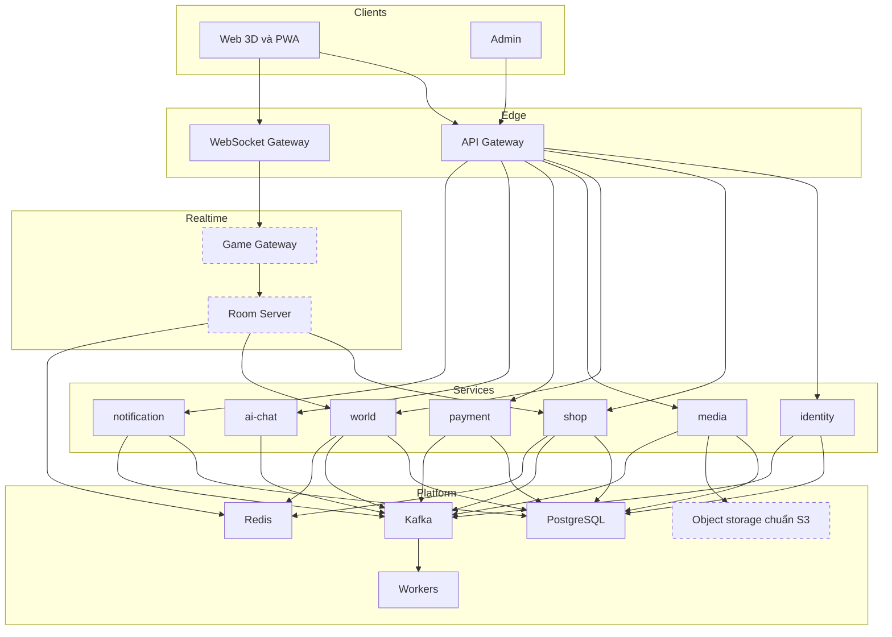

# Kiến trúc

Theo [ADR-0003](../../decisions/ADR-0003-seven-services.md). Các ô nét đứt chưa có hoặc chưa chốt.

## Vai trò từng phần

Xem [danh sách thành phần](./components.md).

## Giao tiếp

| Kiểu                 | Dùng cho                                            | Khai ở đâu                    |
| -------------------- | --------------------------------------------------- | ----------------------------- |
| HTTP qua API Gateway | Client gọi service                                  | `packages/contracts/openapi`  |
| WebSocket            | Gameplay realtime                                   | `packages/contracts/realtime` |
| gRPC                 | Service gọi đồng bộ với nhau, chỉ khi thật cần      | `packages/contracts`          |
| Kafka                | Sự kiện và việc nền, cách mặc định giữa các service | `packages/contracts/events`   |

## Quy tắc kiến trúc

- Mỗi service sở hữu cơ sở dữ liệu của mình. Không đọc thẳng bảng của service khác.
- Tiền và quyền sử dụng chỉ đổi sau khi webhook được xác thực, và xử lý phải an toàn khi lặp lại.
- Game server có thẩm quyền: client chỉ gửi ý định, server quyết định trạng thái.
- Dữ liệu cá nhân chỉ nằm ở service cần nó.

## Hạ tầng dev

`pnpm infra:up` chạy PostgreSQL, Redis, Kafka, Prometheus, Grafana, Loki và OpenTelemetry Collector bằng Docker Compose. Object storage chưa có, xem [câu hỏi mở](../open-questions.md).

| Dịch vụ    | Địa chỉ mặc định                                   |
| ---------- | -------------------------------------------------- |
| PostgreSQL | `localhost:55432`                                  |
| Redis      | `localhost:56379`                                  |
| Kafka      | `localhost:59092`                                  |
| Grafana    | `http://localhost:53000`                           |
| Prometheus | `http://localhost:59090`                           |
| OTLP       | `localhost:54317` (gRPC), `localhost:54318` (HTTP) |
