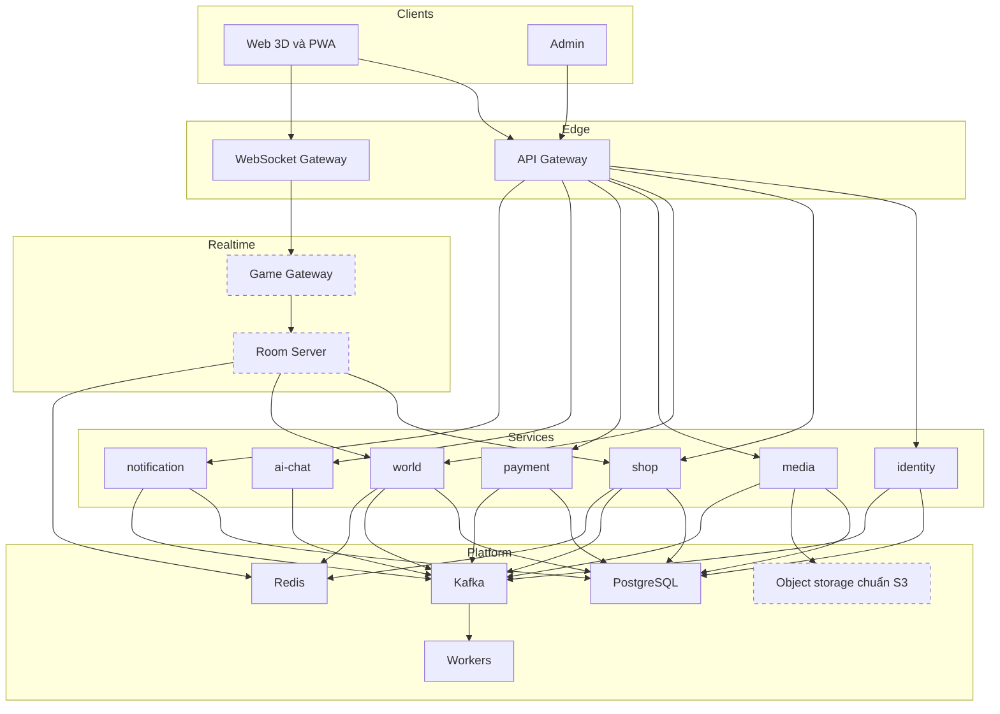

# Kiến trúc

Theo [ADR-0003](../../decisions/ADR-0003-seven-services.md) về số service và [ADR-0020](../../decisions/ADR-0020-monorepo-layout-and-index.md) về bố cục repo. Các ô nét đứt chưa có hoặc chưa chốt.

## Vai trò từng phần

Xem [danh sách thành phần](./components.md).

## Bố cục repo

| Thư mục     | Chứa gì                                                               |
| ----------- | --------------------------------------------------------------------- |
| `apps/`     | Giao diện chạy trên trình duyệt                                       |
| `services/` | Tiến trình phục vụ API hoặc kết nối realtime, mỗi service một thư mục |
| `workers/`  | Tiến trình xử lý việc nền                                             |
| `packages/` | Mã và dữ liệu dùng chung, không tự triển khai                         |
| `infra/`    | Compose, cổng vào `infra/gateway`, cấu hình quan sát                  |
| `tests/`    | Kiểm chạy trên nhiều thành phần: kiểm chuẩn, đầu cuối, tải            |
| `scripts/`  | Công cụ của repo                                                      |
| `docs/`     | Yêu cầu, quyết định, wiki, runbook                                    |

Mỗi thư mục trên có `README.md` sinh từ `docs/catalog.yaml`. Thêm thư mục cấp cao hoặc thành phần mới thì khai trong catalog trước, `pnpm catalog:check` sẽ chặn nếu thiếu.

## Đối chiếu với bản mẫu của mentor

Mentor có một bản backend mẫu ở repo riêng, gồm bốn ứng dụng. Bảy service của nhóm chia nhỏ hơn; phần tương ứng của từng service ghi ở trường `maps_to` trong catalog và ở bảng trong [ADR-0020](../../decisions/ADR-0020-monorepo-layout-and-index.md). Game server của bản mẫu viết bằng Go, nói chuyện với client qua WebSocket bằng JSON. Nhận mã từ bản mẫu phải qua [quy trình nhận service](../../runbooks/import-service.md).

## Chuẩn chung giữa các service

| Tầng                | Nội dung                                                                | Để ở đâu                     |
| ------------------- | ----------------------------------------------------------------------- | ---------------------------- |
| Chuẩn trên dây      | Hình response, lỗi, phân trang, health, nội dung token, vỏ sự kiện, log | `packages/contracts` và wiki |
| Kiểm chuẩn          | Bộ kiểm gọi HTTP thật vào service đang chạy                             | `tests/conformance`          |
| Bộ khung theo stack | Mã dùng chung của các service cùng stack; hiện chỉ có chỗ cho NestJS    | `packages/nest-kit`          |

Service viết bằng Go hoặc Python tự viết phần khung của mình và qua cùng bộ kiểm chuẩn. Service realtime chỉ chịu phần health, token, log và sự kiện.

## Giao tiếp

| Kiểu                 | Dùng cho                                            | Khai ở đâu                       |
| -------------------- | --------------------------------------------------- | -------------------------------- |
| HTTP qua API Gateway | Client gọi service                                  | `packages/contracts/openapi/v1`  |
| WebSocket            | Gameplay realtime                                   | `packages/contracts/realtime/v1` |
| gRPC                 | Service gọi đồng bộ với nhau, chỉ khi thật cần      | `packages/contracts`             |
| Kafka                | Sự kiện và việc nền, cách mặc định giữa các service | `packages/contracts/events/v1`   |

## Quy tắc kiến trúc

- Mỗi service sở hữu cơ sở dữ liệu của mình. Không đọc thẳng bảng của service khác.
- Tiền và quyền sử dụng chỉ đổi sau khi webhook được xác thực, và xử lý phải an toàn khi lặp lại.
- Game server có thẩm quyền: client chỉ gửi ý định, server quyết định trạng thái.
- Dữ liệu cá nhân chỉ nằm ở service cần nó.
- Mỗi thành phần triển khai được phát hành riêng; thay đổi schema và hợp đồng phải chạy được với bản liền trước của bên còn lại. Xem [nhánh và phát hành](./branching-and-release.md).

## Hạ tầng dev

`pnpm infra:up` chạy PostgreSQL, Redis, Kafka, Prometheus, Grafana, Loki và OpenTelemetry Collector bằng Docker Compose. Object storage chưa có, xem [câu hỏi mở](../open-questions.md).

| Dịch vụ    | Địa chỉ mặc định                                   |
| ---------- | -------------------------------------------------- |
| PostgreSQL | `localhost:55432`                                  |
| Redis      | `localhost:56379`                                  |
| Kafka      | `localhost:59092`                                  |
| Grafana    | `http://localhost:53000`                           |
| Prometheus | `http://localhost:59090`                           |
| OTLP       | `localhost:54317` (gRPC), `localhost:54318` (HTTP) |
