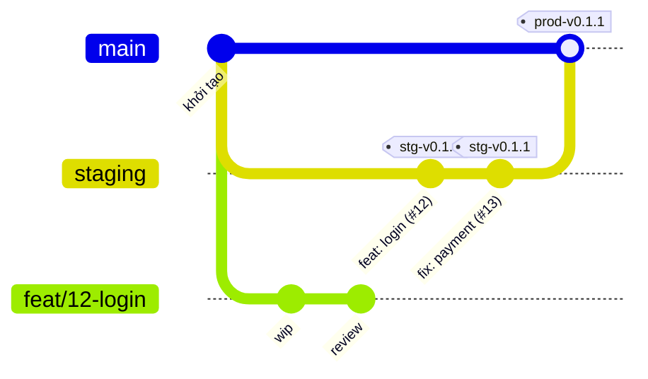

# Nhánh và phát hành

Theo [ADR-0007](../../decisions/ADR-0007-branching-and-release.md).



## Hai môi trường

|                 | Staging                          | Production                                                    |
| --------------- | -------------------------------- | ------------------------------------------------------------- |
| Nhánh           | `staging`, là nhánh mặc định     | `main`                                                        |
| Tag             | `stg-vX.Y.Z`                     | `prod-vX.Y.Z`                                                 |
| Ý nghĩa         | Bản đưa ra test                  | Bản chính thức, đúng số của bản staging đã đạt                |
| Khi phát hành   | Build image của phần có thay đổi | Thành viên khác duyệt rồi mới tạo tag, dùng lại image đã test |
| Dữ liệu, secret | Riêng cho test                   | Thật, tách hoàn toàn                                          |

## Đưa thay đổi vào

| Từ                                     | Vào       | Cách merge   |
| -------------------------------------- | --------- | ------------ |
| `feat/*`, `fix/*`, `docs/*`, `chore/*` | `staging` | Squash       |
| `staging`                              | `main`    | Merge commit |

Thay đổi chỉ đi một chiều từ `staging` lên `main`. Không squash ở bước này: git sẽ coi commit chưa vào `main` và gây xung đột ở vòng sau.

Sau khi merge thì xoá nhánh; việc tiếp theo tạo nhánh mới từ `staging`. Làm tiếp trên nhánh đã squash sẽ gây xung đột.

Promote mang theo mọi thứ đang có trong `staging`, nên việc chưa xong phải ẩn sau feature flag.

## Số phiên bản

Cả hệ thống dùng chung một số phiên bản. CI chỉ build và deploy phần có thay đổi.

- `fix` tăng Z, `feat` tăng Y, thay đổi phá vỡ tăng X.
- Bắt đầu từ `0.1.0`, `1.0.0` dành cho lần ra mắt thật.
- Test lại trên staging thì tăng Z. Production lấy đúng số của bản đạt, nên số production có thể nhảy cóc:

```
stg-v0.1.0   test thấy lỗi thanh toán
stg-v0.1.1   đã sửa, test thấy lỗi đăng nhập
stg-v0.1.2   đã sửa, test đạt
prod-v0.1.2  lên production
```

## Phát hành

Ai có quyền ghi cũng phát hành được và phải đi qua các bước kiểm, kể cả admin. Riêng chủ tổ chức vẫn sửa được cấu hình trong trường hợp khẩn cấp, việc này để lại dấu vết trong audit log. Làm theo [quy trình phát hành](../../runbooks/release.md).

## Sửa lỗi gấp

Sửa gấp là một `fix` bình thường, không có luồng riêng: nhánh `fix/*` vào `staging`, phát hành staging, test đạt rồi đưa lên `main` và phát hành production.

Bản sửa sẽ mang theo mọi thứ đang có trong `staging`, nên việc chưa xong phải luôn ẩn sau feature flag.
