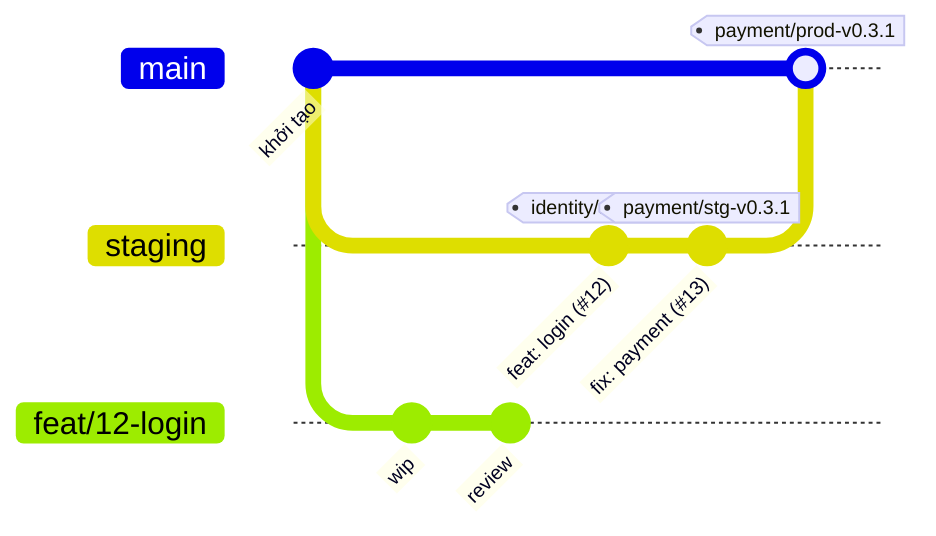

# Nhánh và phát hành

Theo [ADR-0007](../../decisions/ADR-0007-branching-and-release.md) về nhánh và [ADR-0022](../../decisions/ADR-0022-per-component-release-tags.md) về tag.



## Hai môi trường

|                 | Staging                            | Production                                                    |
| --------------- | ---------------------------------- | ------------------------------------------------------------- |
| Nhánh           | `staging`, là nhánh mặc định       | `main`                                                        |
| Tag             | `<id>/stg-vX.Y.Z`                  | `<id>/prod-vX.Y.Z`                                            |
| Ý nghĩa         | Bản của một thành phần đưa ra test | Bản chính thức, đúng số của bản staging đã đạt                |
| Khi phát hành   | Build image của thành phần đó      | Thành viên khác duyệt rồi mới tạo tag, dùng lại image đã test |
| Dữ liệu, secret | Riêng cho test                     | Thật, tách hoàn toàn                                          |

`<id>` là mã thành phần trong `docs/catalog.yaml`, ví dụ `identity/stg-v1.2.0`. Chỉ thành phần có `Dockerfile` mới phát hành được. Package dùng chung không có tag; thay đổi của nó đi theo thành phần dùng nó.

## Đưa thay đổi vào

| Từ                                     | Vào       | Cách merge   |
| -------------------------------------- | --------- | ------------ |
| `feat/*`, `fix/*`, `docs/*`, `chore/*` | `staging` | Squash       |
| `staging`                              | `main`    | Merge commit |

Thay đổi chỉ đi một chiều từ `staging` lên `main`. Không squash ở bước này: git sẽ coi commit chưa vào `main` và gây xung đột ở vòng sau.

Sau khi merge thì xoá nhánh; việc tiếp theo tạo nhánh mới từ `staging`. Làm tiếp trên nhánh đã squash sẽ gây xung đột.

Đưa `staging` lên `main` mang theo mã của mọi thành phần, nhưng chỉ thành phần được phát hành mới lên production. Mã trên `main` vì vậy có thể mới hơn bản đang chạy của một thành phần.

## Số phiên bản

Mỗi thành phần triển khai có dòng số phiên bản riêng.

- `fix` tăng Z, `feat` tăng Y, thay đổi phá vỡ tăng X.
- Bắt đầu từ `0.1.0`, `1.0.0` dành cho lần ra mắt thật.
- Số mới phải lớn hơn bản trước của chính thành phần đó.
- Test lại trên staging thì tăng Z. Production lấy đúng số của bản đạt, nên số production có thể nhảy cóc:

```
payment/stg-v0.3.0   test thấy lỗi webhook
payment/stg-v0.3.1   đã sửa, test thấy lỗi hoá đơn
payment/stg-v0.3.2   đã sửa, test đạt
payment/prod-v0.3.2  lên production
```

## Điều kiện của tag production

Tag `<id>/prod-vX.Y.Z` chỉ được tạo khi:

- Lần chạy nằm trên `main`.
- Đã có `<id>/stg-vX.Y.Z`.
- Nội dung của thành phần trên `main` giống tag staging đó. Nội dung gồm thư mục của thành phần, các package nó phụ thuộc và các tệp gốc dùng chung như `pnpm-lock.yaml`.

Thay đổi chưa phát hành của thành phần khác không chặn và không đi theo.

## Phát hành

Ai có quyền ghi cũng phát hành được và phải đi qua các bước kiểm, kể cả admin. Riêng chủ tổ chức vẫn sửa được cấu hình trong trường hợp khẩn cấp, việc này để lại dấu vết trong audit log. Làm theo [quy trình phát hành](../../runbooks/release.md).

## Sửa lỗi gấp

Sửa gấp là một `fix` bình thường, không có luồng riêng:

1. Xác định thành phần có lỗi.
2. Nhánh `fix/*` vào `staging`.
3. Phát hành staging cho riêng thành phần đó, tăng Z.
4. Test đạt thì đưa `staging` lên `main` và phát hành production cho riêng thành phần đó.

Các thành phần khác giữ nguyên bản đang chạy, kể cả lúc mã của chúng trên `main` đã đổi.

## Việc chưa xong

- Việc chưa xong của một thành phần không lên production cho tới lúc chính thành phần đó được phát hành.
- Việc chưa xong nằm trong cùng thành phần sắp phát hành, hoặc trong package dùng chung mà nó phụ thuộc, vẫn phải ẩn sau feature flag hoặc được revert trước lúc phát hành.
- Thay đổi schema và hợp đồng phải chạy được với bản liền trước của bên còn lại, vì các thành phần lên production ở những thời điểm khác nhau.

## Cờ tính năng

Cờ tính năng ẩn một việc chưa xong đã nằm trong mã. Mỗi cờ được khai trong `docs/flags.yaml`:

```yaml
flags:
  - name: machine-license
    component: payment
    owner: tên GitHub của người phụ trách
    remove_by: 2027-01-31
    summary: Chủ tiệm mua license máy
```

- Mã đọc cờ qua biến môi trường `FLAG_<TÊN>`, ví dụ `FLAG_MACHINE_LICENSE`. Mã chạy trong trình duyệt dùng `NEXT_PUBLIC_FLAG_<TÊN>`.
- Cờ chỉ bật lúc biến có đúng giá trị `true`. Không khai biến thì cờ tắt, nên production mặc định không thấy việc chưa xong.
- `pnpm flags:check` đỏ lúc mã đọc một cờ chưa khai, lúc cờ đã khai mà không còn mã nào đọc, và lúc cờ quá ngày `remove_by`.
- Việc xong thì gỡ cả đoạn mã đọc cờ lẫn dòng khai trong một PR.

## Giữ `staging` luôn phát hành được

- Việc dài hơn một PR phải nằm sau cờ tính năng ngay từ PR đầu tiên.
- PR làm hỏng một thành phần trên `staging` thì revert PR đó trước, rồi sửa trên nhánh mới. Không để `staging` hỏng trong lúc chờ bản sửa.
- Trước lúc phát hành một thành phần, xem các thay đổi chưa phát hành của nó và của package nó phụ thuộc: cái nào chưa xong thì phải sau cờ hoặc được revert.
- Thay đổi schema theo ba bước: thêm phần mới, chuyển bên đọc sang phần mới, rồi mới gỡ phần cũ ở một bản sau.
