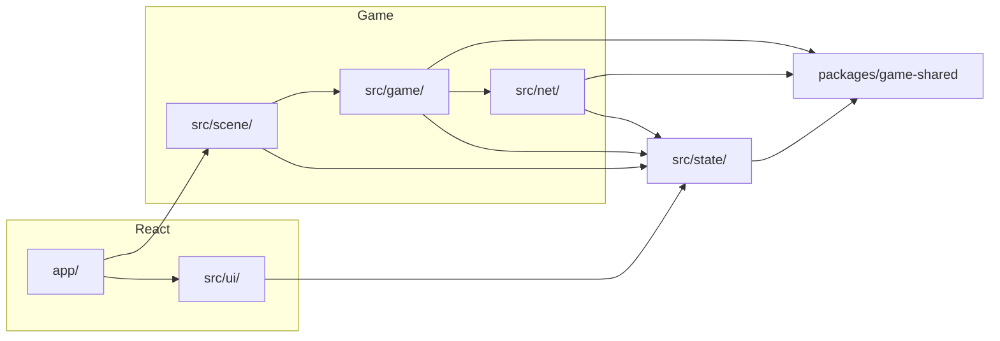

# Client game

Toàn bộ giao diện của người chơi và chủ tiệm nằm trong `apps/web-3d`. Trang này nói mã đặt ở đâu và lớp nào được gọi lớp nào. Quyết định gốc: [ADR-0017](../../decisions/ADR-0017-web-client-layers.md).

## Hai thế giới trong một trang

| Lớp          | Là gì                                        | Công nghệ                          | Nhịp                       |
| ------------ | -------------------------------------------- | ---------------------------------- | -------------------------- |
| Thế giới 3D  | Tiệm, nhân vật, camera, ánh sáng             | Three.js thuần trên một `<canvas>` | Vẽ lại mỗi khung hình      |
| Giao diện 2D | Đăng nhập, hộp thuê máy, đồng hồ phiên, menu | React trong Next.js                | Chỉ vẽ lại lúc dữ liệu đổi |

React dựng thẻ `<canvas>` một lần rồi giao cho Three.js. Từ đó hai bên không gọi nhau, chỉ đọc và ghi chung một kho trạng thái.



## Thư mục

```
apps/web-3d/
├─ app/         Trang, route, component gắn canvas
├─ src/
│  ├─ scene/    Three.js: dựng tiệm, nhân vật, camera, ánh sáng, mức chất lượng
│  ├─ game/     Vòng lặp và luật phía client: nhập phím, cần ảo, tương tác, ngồi máy
│  ├─ net/      Kết nối phòng: bản WebSocket và bản giả
│  ├─ ui/       Component React phủ trên canvas
│  └─ state/    Kho trạng thái nối game với giao diện
├─ dev/         Room server giả, chỉ dùng lúc phát triển
├─ test/        Test chạy trên bản build bằng trình duyệt
├─ public/      Tệp tĩnh; mô hình 3D được chép vào đây lúc build, không commit
└─ scripts/     Chép asset, chạy bản xem thử
```

## Mã mới đặt ở đâu

| Việc                                            | Thư mục                |
| ----------------------------------------------- | ---------------------- |
| Trang mới, route mới                            | `app/`                 |
| Component giữ thẻ `<canvas>` và khởi động cảnh  | `app/`                 |
| Nút, hộp thoại, đồng hồ, gợi ý phím             | `src/ui/`              |
| Dựng mô hình, vật liệu, ánh sáng, camera        | `src/scene/`           |
| Đọc phím, cần ảo; quyết định đi, ngồi, đứng dậy | `src/game/`            |
| Gửi và nhận thông điệp với phòng                | `src/net/`             |
| Dữ liệu mà cả game lẫn giao diện cần biết       | `src/state/`           |
| Luật mà server cũng phải chạy y hệt             | `packages/game-shared` |
| Mô hình, công thức tiệm, mã lắp tiệm            | `packages/game-assets` |
| Component dùng chung với trang admin            | `packages/ui`          |

## Luật phụ thuộc

- `scene`, `game`, `net`, `state` không import React, `react-redux` hay Next.js.
- `ui` và `app` không import Three.js.
- `game`, `net`, `state` không import Three.js: chỉ `scene` nói chuyện với Three.js.
- `ui` không import `scene`, `game`, `net`. Muốn biết gì thì đọc `state`, muốn làm gì thì gửi lệnh vào `state`.
- `state` không import lớp nào khác trong ứng dụng.
- `app` là nơi duy nhất được import cả `ui` lẫn `scene`.
- `packages/game-shared` không import Three.js, React hay mã trong `apps/`, `services/`.

`pnpm boundaries:check` kiểm các luật này và chạy trong `pnpm verify`. Luật khai ở `scripts/boundaries/rules.mjs`.

## Một tính năng đi qua các lớp ra sao

Ví dụ gợi ý "Nhấn E để thuê máy":

1. `game` mỗi nhịp tính máy gần nhất trong tầm với, ghi `nearbySeat` vào `state`.
2. `ui` đọc `nearbySeat` và hiện gợi ý.
3. Người chơi nhấn E. `game` đọc phím, gọi `net` gửi yêu cầu ngồi.
4. `net` nhận trả lời của phòng, ghi kết quả vào `state`.
5. `scene` đọc `state`, đặt nhân vật vào ghế và phát clip ngồi.
6. `ui` đọc `state`, hiện đồng hồ phiên.

Không bước nào có React gọi Three.js hay ngược lại.

## Vòng lặp mỗi khung hình

Thứ tự cố định, để hai máy khác tốc độ khung hình vẫn ra cùng kết quả:

1. Đọc đầu vào thành một vector ý định.
2. Chạy các nhịp mô phỏng đã tới hạn bằng `advanceSimulation` của `game-shared`, mỗi nhịp dài 1/30 giây.
3. Ghi phần giao diện cần biết vào `state`.
4. Nội suy vị trí giữa hai nhịp rồi vẽ.

Luật chơi chỉ chạy ở bước 2. Bước 4 không được đổi trạng thái game.

## Quy ước trong ứng dụng

- Mã viết bằng TypeScript. Tên tệp chữ thường nối gạch: `shop-scene.ts`, `seat-prompt.tsx`.
- Test đặt cạnh tệp nguồn: `quality.ts` đi với `quality.test.ts`. Test cần trình duyệt nằm ở `test/`.
- Mọi thứ cấp phát trên GPU (geometry, material, texture) phải có đường giải phóng lúc rời cảnh.
- Mô hình và công thức tải lúc chạy từ `public/game-assets/`, không import vào bundle.
- Mức chất lượng do `scene` chọn theo máy; giao diện chỉ đọc mức đang dùng từ `state`.
- Mất ngữ cảnh WebGL thì dựng lại cảnh từ `state`, không tải lại trang.

## Vận hành

- `next build` xuất ra thư mục tĩnh gồm HTML, JS và mô hình 3D, đặt sau CDN hoặc nginx.
- Việc vẽ 3D chạy trên máy người chơi. Server chỉ phục vụ API và phòng realtime.
- Địa chỉ API và phòng là cấu hình lúc build. Room server giả trong `dev/` không được có mặt trong bản build production.

## Kho trạng thái

Kho trạng thái dùng Redux Toolkit.

- `src/state/` chứa store và các slice, chỉ dùng `@reduxjs/toolkit`. Gói `react-redux` chỉ được dùng ở `ui` và `app`.
- `scene`, `game`, `net` đọc bằng `store.getState()` hoặc `store.subscribe()`, ghi bằng `store.dispatch()`.
- Kho chỉ giữ thứ giao diện cần và đổi thưa: máy đang trong tầm, phiên thuê, trạng thái kết nối, mức chất lượng, lỗi.
- Thứ đổi theo từng nhịp (vị trí, hướng nhìn, khung xương) không đi qua kho. Chúng nằm trong mô phỏng của `game` và `scene` đọc thẳng từ đó. Đưa vào kho thì mỗi giây có 30 lần dispatch và React vẽ lại liên tục.
- Dữ liệu trong kho phải là đối tượng thuần, tuần tự hoá được. `Map` của trạng thái phòng phải đổi thành đối tượng hoặc mảng trước lúc đưa vào.

## Chữ hiển thị

- Mọi chữ người chơi nhìn thấy nằm trong `src/ui/text/vi.ts`, component gọi theo khoá. Mã không chứa câu tiếng Việt.
- Hiện chỉ có tiếng Việt. Thêm ngôn ngữ khác là thêm một tệp cùng bộ khoá.
- Mã lỗi từ server là khoá để tra câu hiển thị, không hiện thẳng thông điệp của server.

## CSS

- Mỗi component một tệp `.module.css` đặt cạnh nó.
- Màu, cỡ chữ, khoảng cách lấy từ biến CSS khai ở `app/globals.css`, không ghi số màu trong component.
- `globals.css` chỉ chứa biến và phần đặt lại mặc định của trình duyệt.

## Máy tối thiểu

Game phải đạt 30 khung hình mỗi giây trong một tiệm 50 máy trên laptop văn phòng 5 năm tuổi: card tích hợp cỡ Intel UHD 620, RAM 8 GB.

- Máy mạnh hơn dùng mức chất lượng cao hơn; không tính năng nào được chỉ chạy ở mức cao.
- Điện thoại vào được ở mức chất lượng thấp, không cam kết số khung hình.
- Trần tam giác, lời gọi vẽ và dung lượng tải cho cả cảnh sẽ ghi ở đây sau lần đo trên máy tối thiểu.
