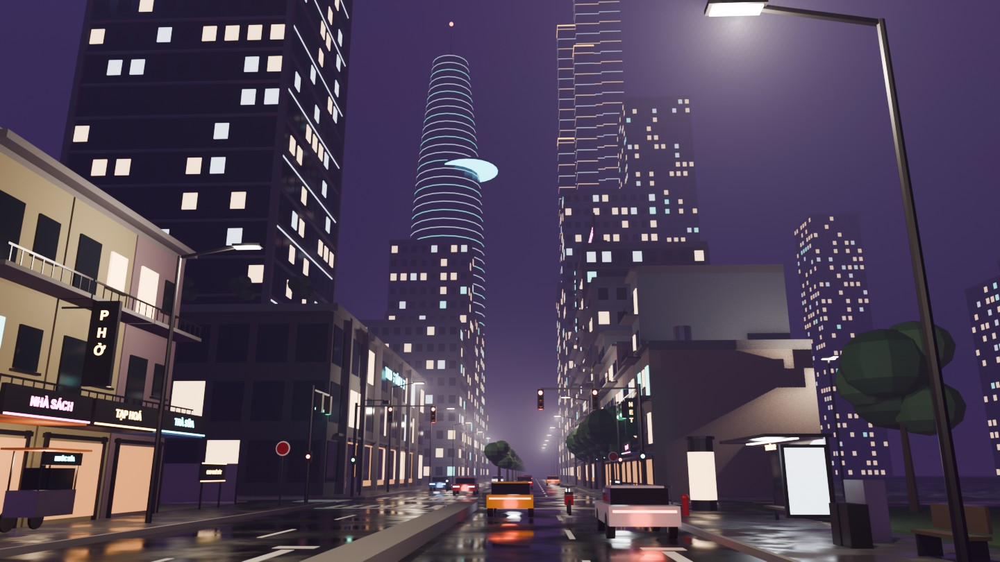
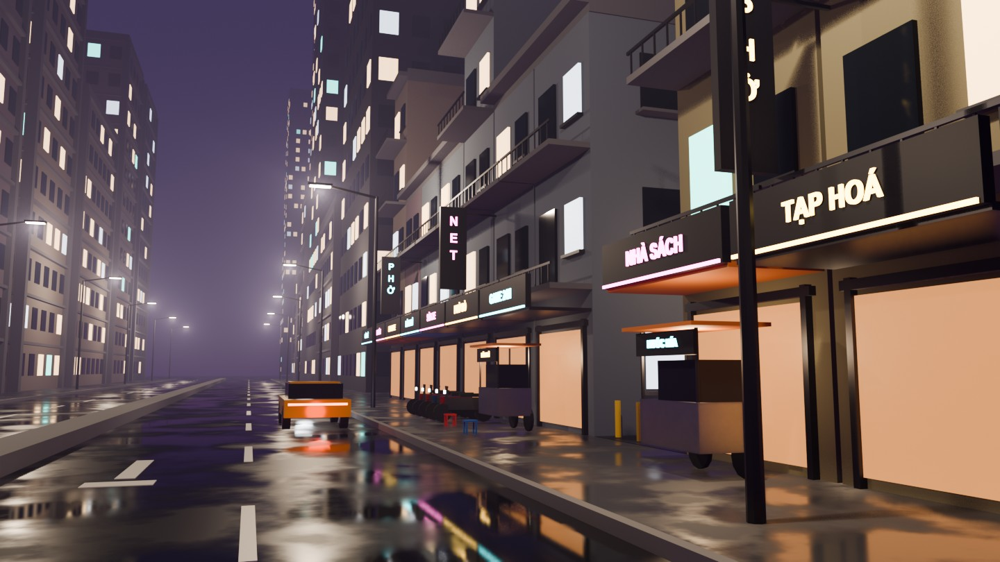
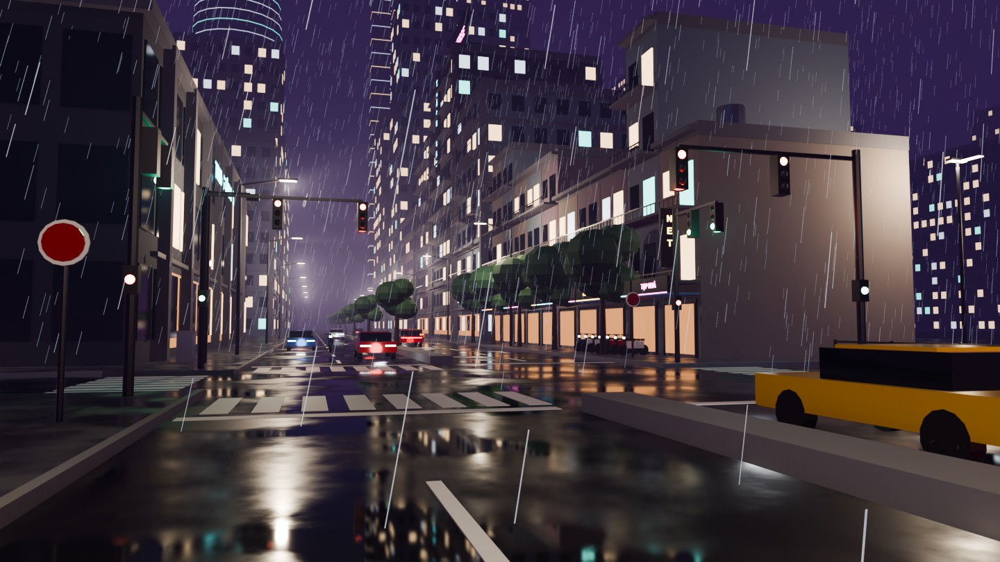

# Tiêu chí mỹ thuật thành phố

Trang này quy định các tiêu chí mỹ thuật cho khối hình, vật liệu, ánh sáng, mặt đường, xe và thời tiết cho thành phố Sài Gòn cyber theo [REQ-039](../../requirements/registry.yaml), [REQ-042](../../requirements/registry.yaml), [ADR-0014](../../decisions/ADR-0014-saigon-cyber-and-own-characters.md) và [ADR-0019](../../decisions/ADR-0019-registered-parts-and-one-render-standard.md). Bảng tiêu chí gốc được đề xuất tại [issue 258](https://github.com/netverse3d/netverse3d/issues/258) dựa trên ba video tham chiếu của người dẫn dắt (ngôi làng dựng trong Blender, cảnh xe chạy lúc chạng vạng, phố đêm mưa có neon).

> **Quy định xét duyệt:** Bảng tiêu chí này phải được người dẫn dắt (mentor) phê duyệt. Mọi điều chỉnh, bổ sung tiêu chí trong quá trình phát triển được thực hiện trực tiếp trên trang wiki này thông qua pull request, không bàn thảo và sửa đổi rải rác trong các issue riêng lẻ.

## Bối cảnh và nguyên tắc áp dụng

Chỉ học tập phương pháp xử lý thẩm mỹ từ video tham chiếu; không sao chép mô hình, texture hay cảnh dựng của bên ngoài. Bối cảnh thế giới là TP.HCM phiên bản cyber về đêm ([ADR-0014](../../decisions/ADR-0014-saigon-cyber-and-own-characters.md)).

Ba ảnh dưới đây do nhóm tự dựng để minh hoạ trực quan các nhóm tiêu chí. Ảnh đích chi tiết cho từng hạng mục công việc nằm tại [ảnh đích thành phố](./city-targets.md).

> **Ảnh chỉ mang tính định hướng.** Ảnh chỉ định hướng về ánh sáng, bố cục, tỉ lệ và không khí. Dựng mô hình giống hệt ảnh là **không đạt**: mỗi thành phần phải có thiết kế riêng và đạt đủ các tiêu chí hình khối, vật liệu bên dưới.

Video tham chiếu là kết xuất ngoại tuyến (offline rendering) mất nhiều giờ cho vài giây. Netverse 3D chạy thời gian thực trên trình duyệt máy tính và điện thoại ([REQ-004](../../requirements/registry.yaml)), do đó kỹ thuật thể hiện phải tuân thủ [ngân sách hiệu năng](../engineering/performance-budget.md). Mỗi tiêu chí dưới đây ghi theo kết quả nhìn thấy kèm cách đạt được trong thời gian thực.

---

## Bảng tiêu chí mỹ thuật

### Q. Quy trình

| Mã     | Tiêu chí                                                                                                                    | Cách đạt thời gian thực                                                                                                                                                                                                                                                                                                                                                        |
| :----- | :-------------------------------------------------------------------------------------------------------------------------- | :----------------------------------------------------------------------------------------------------------------------------------------------------------------------------------------------------------------------------------------------------------------------------------------------------------------------------------------------------------------------------- |
| **Q1** | Dựng khối xám trước: chốt tỉ lệ, bố cục và đường chân trời bằng khối trơn, đưa duyệt, rồi mới làm vật liệu, đồ và ánh sáng. | Dùng cờ `--preview` (`pnpm assets:generate <kit> --preview`) sinh khối trơn trong vài giây để phác dáng; canh tỉ lệ theo lưới ô 4 m (`STREET_CELL = 4` trong `runtime/street-look.mjs`); đối chiếu với [ảnh đích thành phố](./city-targets.md) và runbook [phác hình Blender](../../runbooks/blender-mcp-sketch.md).                                                           |
| **Q2** | Duyệt từng lớp theo thứ tự khối, vật liệu, đồ, ánh sáng; không gộp bốn lớp vào một lần duyệt.                               | Quy trình phân lớp: hình khối kiểm bằng cờ `--preview` và `tools/coplanar.mjs`; vật liệu kiểm qua bảng màu palette (`runtime/shop-look.mjs`); đồ rời theo ô đồ `slots` trong `assets.config.json`; ánh sáng kiểm qua các bộ ánh sáng đặt tên trong `runtime/lighting.mjs`. Hướng dẫn duyệt chi tiết quy định tại [#244](https://github.com/netverse3d/netverse3d/issues/244).  |
| **Q3** | Mỗi món đưa duyệt kèm ảnh cạnh nhân vật và ảnh dưới bộ ánh sáng phố đêm.                                                    | Chưa chốt đầy đủ: đã có script `pipeline/render_part.py` render 4 góc; so tỉ lệ với nhân vật mẫu (`player.glb`) trong thư viện (`library/characters.html`, `library/checks.html`); xem dưới bộ ánh sáng phố đêm `OUTDOOR_LIGHTING` trong `runtime/street-look.mjs`. Phòng thử ánh sáng chuyên biệt trên web thuộc [#238](https://github.com/netverse3d/netverse3d/issues/238). |

### H. Hình khối

| Mã     | Tiêu chí                                                                                                              | Cách đạt thời gian thực                                                                                                                                                                                                                                                                                                                                                             |
| :----- | :-------------------------------------------------------------------------------------------------------------------- | :---------------------------------------------------------------------------------------------------------------------------------------------------------------------------------------------------------------------------------------------------------------------------------------------------------------------------------------------------------------------------------- |
| **H1** | Không có hộp trơn. Mỗi mặt tiền có ít nhất ba lớp sâu thật bằng hình học: khung hoặc cột nổi, mặt tường, cửa lõm vào. | Phân lớp hình học module `shopfront` và `storey` trong `street-parts.glb` (`pipeline/hero_street.py`), kiểm tra độ phẳng và chồng lấn qua `checkCoplanar` / `facadeAssemblies` trong `tools/coplanar.mjs`. Giữ trần tam giác cho `shopfront` (600) và `storey` (1.000) theo [ngân sách hiệu năng](../engineering/performance-budget.md).                                            |
| **H2** | Các tầng không thẳng một mặt phẳng: có ban công, mái đua, tầng nhô, giá đỡ nhìn thấy được.                            | Module tầng `storey_a`, `storey_b` và mái `roof_a` trong `street-parts.glb` có độ nhô thực tế theo chiều sâu (sâu 1,3 m – 1,35 m, cao 3,85 m), kiểm tra ghép tầng qua `facadeAssemblies` trong `tools/coplanar.mjs`. Hệ module toà phức hợp mở rộng tại [#251](https://github.com/netverse3d/netverse3d/issues/251) và [#252](https://github.com/netverse3d/netverse3d/issues/252). |
| **H3** | Chỗ hai khối gặp nhau có chi tiết che mối nối: bậu, gờ, nẹp, máng xối.                                                | Kiểm tra mặt phẳng tiếp giáp không bị lỗi Z-fighting bằng công cụ `tools/coplanar.mjs` (`coplanarOverlaps` với `acrossOnly: true`), hình học bậu và gờ mép trong module `street-parts.glb` và `environment-kit.blend`.                                                                                                                                                              |
| **H4** | Hình dáng đọc ra được từ xa chỉ bằng bóng đen của nó.                                                                 | Áp dụng cho các mô hình nền xa `skyline-parts.glb` (`landmark_a`, `bridge_a`, `highrise_a/b/c` theo [#186](https://github.com/netverse3d/netverse3d/issues/186)), chậu cây `planter_a`, biển nóc nhà `rooftop` và trụ đèn `sign-parts.glb`. Hai tháp điểm nhấn chi tiết đang phát triển ở [#253](https://github.com/netverse3d/netverse3d/issues/253).                              |
| **H5** | Vát cạnh ở mọi cạnh người chơi tới gần để cạnh bắt được ánh sáng.                                                     | Lệnh vát góc `bmesh.ops.bevel` với góc cạnh cứng và bán kính vát quy chuẩn trong thư viện sinh mô hình `packages/game-assets/pipeline/hero_kit.py` (`HeroPart.rounded_box`) và `pipeline/hero_traffic.py`.                                                                                                                                                                          |

### V. Vật liệu

| Mã     | Tiêu chí                                                                                                                   | Cách đạt thời gian thực                                                                                                                                                                                                                                                                                                                                                                                    |
| :----- | :------------------------------------------------------------------------------------------------------------------------- | :--------------------------------------------------------------------------------------------------------------------------------------------------------------------------------------------------------------------------------------------------------------------------------------------------------------------------------------------------------------------------------------------------------- |
| **V1** | Ba cỡ chi tiết trên mỗi bề mặt lớn: mảng lớn, đơn vị vừa (viên gạch, tấm ốp, viên ngói), vết nhỏ (ố, bong, rêu, vệt nước). | Chưa chốt: chuẩn nướng 3 cỡ chi tiết cho mô hình cỡ công trình và mặt đường thuộc [#237](https://github.com/netverse3d/netverse3d/issues/237). Mảng vừa hiện có trên texture ô đường và vỉa hè trong `street-parts.glb`.                                                                                                                                                                                   |
| **V2** | Các đơn vị lặp có biến thiên màu và độ nhám giữa từng viên; không có mảng nào một màu phẳng rộng quá 2 m.                  | Chưa chốt: giải pháp biến thiên màu và độ nhám giữa các module lặp ngoài phố thuộc [#237](https://github.com/netverse3d/netverse3d/issues/237). Hiện các bề mặt đổi màu qua palette chung trong `runtime/shop-look.mjs`.                                                                                                                                                                                   |
| **V3** | Hao mòn đặt ở chỗ có lý do: chân tường, mép mái, quanh cửa, vệt nước dưới bậu.                                             | Chưa chốt: quy chuẩn nướng vết ố, bong tróc và vết nước cho khối phố thuộc [#237](https://github.com/netverse3d/netverse3d/issues/237). Đồ nội thất và module phòng đã có lớp che khuất môi trường (AO map) trong `pipeline/hero_kit.py`.                                                                                                                                                                  |
| **V4** | Độ nhám là thứ kể chất liệu: kính và sơn xe bóng, nhựa đường nhám, kim loại cũ loang.                                      | Vật liệu PBR Three.js: xe có sơn bóng (`createVehicle` trong `runtime/vehicle-look.mjs`, màu trong `VEHICLE_PAINT_COLORS`, kính tối `roughness` thấp), mặt đường nhựa nhám (`baseRoughness: 0.85`, tính lại qua `calculateRoadRoughness` trong `runtime/weather.mjs` và áp trong `street-look.mjs`). Chuẩn độ nhám chung cho công trình thuộc [#237](https://github.com/netverse3d/netverse3d/issues/237). |

### B. Bố cục phố

| Mã     | Tiêu chí                                                                                                       | Cách đạt thời gian thực                                                                                                                                                                                                                                                                                                                                                                                                                                                                                                     |
| :----- | :------------------------------------------------------------------------------------------------------------- | :-------------------------------------------------------------------------------------------------------------------------------------------------------------------------------------------------------------------------------------------------------------------------------------------------------------------------------------------------------------------------------------------------------------------------------------------------------------------------------------------------------------------------- |
| **B1** | Cùng bộ module nhưng hai nhà cạnh nhau khác nhau ít nhất hai thứ trong: chiều cao, kiểu mái, nhịp cửa sổ, màu. | Biến thể ô đồ `variants` trong `assets.config.json` (`storey` có `a`, `b`; `roof` có `a`; `shopfront` có `a`) và kế hoạch đặt part `streetPlan` trong `blocks/hem-mau.json`. Hệ toà nhà phức hợp nhiều module chiều cao đang mở rộng tại [#251](https://github.com/netverse3d/netverse3d/issues/251) và [#252](https://github.com/netverse3d/netverse3d/issues/252).                                                                                                                                                        |
| **B2** | Phố không thẳng tắp và không phẳng lì: có chỗ lệch hàng, chỗ thụt, chỗ nhô.                                    | Lưới ô phố `STREET_CELL = 4` m, bước lùi vỉa hè `SIDEWALK_DEPTH = 1` m trong `runtime/street-look.mjs`; lô đất thụt vào `lotFrontage` trong `runtime/traffic.mjs`; ô cua `road_b`, ngã ba `road_c` trong `street-parts.glb`. Nút giao và đường lớn đang mở rộng ở [#247](https://github.com/netverse3d/netverse3d/issues/247) và [#248](https://github.com/netverse3d/netverse3d/issues/248).                                                                                                                               |
| **B3** | Đồ kể chuyện tụ thành cụm ở chân tường và góc phố, không rải đều: thùng, xe đẩy, thang, ghế, két nước.         | Bố trí cụm theo điểm neo trong dữ liệu cảnh (`blocks/hem-mau.json`); bộ tiện ích phố `furniture-parts.glb` (ghế, thùng rác `binpair`, tủ điện `cabinet`, trụ nước `hydrant`, trạm chờ `shelter` trong [#250](https://github.com/netverse3d/netverse3d/issues/250)), quán cà phê vỉa hè trong [#223](https://github.com/netverse3d/netverse3d/issues/223), xe hàng rong trong [#222](https://github.com/netverse3d/netverse3d/issues/222), đồ lặt vặt hẻm trong [#226](https://github.com/netverse3d/netverse3d/issues/226). |
| **B4** | Có vật nối hai bên đường ở trên cao để tạo chiều sâu: dây điện, dây đèn, biển vươn ra.                         | Slot `wires` (dây điện giăng ngang hẻm lưới 4 m) trong `street-parts.glb`; slot `festoon` (dây đèn võng 4 m có 9 bóng phát sáng) và `lantern` (đèn lồng) trong `sign-parts.glb` ([#221](https://github.com/netverse3d/netverse3d/issues/221)); biển vẫy `blade` và biển ngang `sign` vươn ra từ tường nhà.                                                                                                                                                                                                                  |
| **B5** | Cuối mỗi trục nhìn dài có một công trình cao làm điểm tựa, mờ trong sương.                                     | Bộ đường chân trời `skyline-parts.glb` (`landmark_a`, `bridge_a`, `highrise_a/b/c` theo [#186](https://github.com/netverse3d/netverse3d/issues/186)), kết hợp sương xa `OUTDOOR_LIGHTING.fog` trong `runtime/street-look.mjs` và `environments.night-sky.fog` trong `assets.config.json`. Tháp điểm nhấn hai bên trục nhìn chính trong khu đang mở rộng tại [#253](https://github.com/netverse3d/netverse3d/issues/253).                                                                                                    |

### A. Ánh sáng

| Mã     | Tiêu chí                                                                                                     | Cách đạt thời gian thực                                                                                                                                                                                                                                                                                                                                                                                                                                 |
| :----- | :----------------------------------------------------------------------------------------------------------- | :------------------------------------------------------------------------------------------------------------------------------------------------------------------------------------------------------------------------------------------------------------------------------------------------------------------------------------------------------------------------------------------------------------------------------------------------------ |
| **A1** | Tương phản ấm và lạnh: nền trời, sương và bóng tối ngả lạnh; cửa sổ, đèn đường, đèn lồng ấm.                 | Nền trời và sương ngả lạnh: `NIGHT_SKY` (zenith `#080614`, horizon `#24193d`, sương `#24193d`, trăng `#9fb4ff`) trong `runtime/street-look.mjs` và `assets.config.json`; đèn đường và đèn lồng ấm: `hemisphere.ground` (`#120c24`), `EMISSIVE_SCALE.streetLamp` (`default: 3.0`), dây đèn `festoon` và đèn lồng `lantern` (`sign-parts.glb`). Thống nhất nguồn ánh sáng chung hoàn thiện ở [#233](https://github.com/netverse3d/netverse3d/issues/233). |
| **A2** | Nền tối thật sự. Vùng sáng chiếm phần nhỏ của khung hình, nên mỗi nguồn sáng đều có giá trị.                 | Phơi sáng và môi trường tối: `OUTDOOR_LIGHTING.exposure = 1.0`, `environmentIntensity = 0.45` trong `runtime/street-look.mjs` và `assets.config.json`; ngân sách đèn động tối đa 6 đèn mỗi khối phố (`LIGHT_BUDGET.maxDynamicLightsPerBlock = 6` trong `runtime/lighting.mjs` và `assets.config.json`), chỉ đèn điểm nhấn phát sáng qua `EMISSIVE_SCALE`.                                                                                               |
| **A3** | Đèn nhỏ đặt theo nhịp dọc phố để dẫn mắt vào sâu.                                                            | Bố trí đèn đường `lamp_a` / `streetlight_a/b` theo nhịp lưới 4 m hoặc 8 m dọc vỉa hè (`street-parts.glb`, [#249](https://github.com/netverse3d/netverse3d/issues/249)); dây đèn `festoon_a` giăng liên tiếp theo nhịp hẻm.                                                                                                                                                                                                                              |
| **A4** | Sương làm vật ở xa nhạt dần và ngả về màu trời; lớp gần, lớp giữa, lớp xa tách nhau rõ.                      | Three.js Fog phân tách 3 lớp trong `runtime/street-look.mjs` và `assets.config.json` (`environments.night-sky.fog`: near 16 m, far 90 m, density 0.018); cập nhật động theo thời tiết qua `applyWeatherToOutdoor` (sương dày kéo near về 4 m, far về 35 m). Đã chốt và nghiệm thu tại [#235](https://github.com/netverse3d/netverse3d/issues/235).                                                                                                      |
| **A5** | Quanh mỗi nguồn sáng có quầng mềm trong sương; có tia sáng xuyên qua khe giữa hai dãy nhà ở những điểm nhấn. | Chưa chốt đầy đủ: quầng phát sáng dùng bloom chuẩn `STANDARD_BLOOM` (strength: 0.35, radius: 0.4, threshold: 0.85) trong `runtime/lighting.mjs`; quầng sương mềm và tia sáng qua khe nhà thời gian thực thuộc [#236](https://github.com/netverse3d/netverse3d/issues/236) và [#233](https://github.com/netverse3d/netverse3d/issues/233), tắt ở mức chất lượng thấp theo [ngân sách hiệu năng](../engineering/performance-budget.md).                   |
| **A6** | Neon tiết chế: mỗi đoạn phố dùng hai tới ba màu neon, mỗi biển một màu, chữ đọc được.                        | Thang phát sáng `EMISSIVE_SCALE.neon` (min 1.8, max 2.8, default 2.2) trong `runtime/lighting.mjs` và `assets.config.json` (chốt từ [#236](https://github.com/netverse3d/netverse3d/issues/236)). Vật liệu biển hiệu tách lớp: viền ống neon `strip` và `accent` phát sáng, mặt chữ `decal` nền tối `body` theo chuẩn trong [game-assets](../engineering/game-assets.md).                                                                               |
| **A7** | Cửa sổ sáng theo ô không đều, khoảng một phần ba số ô, vài ô màu khác.                                       | Thang phát sáng `EMISSIVE_SCALE.window` (min 0.6, max 1.3, default 0.9) trong `runtime/lighting.mjs` và `assets.config.json` (chốt từ [#236](https://github.com/netverse3d/netverse3d/issues/236)). Texture cửa sổ `storey_a/b` và tháp `highrise` chỉ bật sáng ~1/3 diện tích ô kính qua dải phát sáng `glow` ngẫu nhiên.                                                                                                                              |
| **A8** | Mọi vật chạm đất đều có bóng tiếp đất.                                                                       | Chưa chốt: kỹ thuật đổ bóng thời gian thực cho nhân vật, xe và đồ chuyển động thuộc [#234](https://github.com/netverse3d/netverse3d/issues/234) (đang phân tích giữa đĩa bóng mềm, bóng chiều sâu và shadow map; đồ tĩnh dùng `aoMap` nướng sẵn).                                                                                                                                                                                                       |

### M. Mặt đường và phản chiếu

| Mã     | Tiêu chí                                                                           | Cách đạt thời gian thực                                                                                                                                                                                                                                                                                                                                                                                                                                        |
| :----- | :--------------------------------------------------------------------------------- | :------------------------------------------------------------------------------------------------------------------------------------------------------------------------------------------------------------------------------------------------------------------------------------------------------------------------------------------------------------------------------------------------------------------------------------------------------------- |
| **M1** | Mặt đường là nơi ánh sáng hạ xuống: ướt, phản chiếu đèn và neon thành vệt kéo dài. | Độ nhám mặt đường giảm khi ướt qua hàm `calculateRoadRoughness` trong `runtime/weather.mjs` (lerp từ 0.85 xuống 0.15 theo `weather.wetness`) và cập nhật vào `materials.surface.roughness` trong `applyWeatherToOutdoor` (`runtime/street-look.mjs`). Tắt vệt phản chiếu ở mức chất lượng thấp theo [ngân sách hiệu năng](../engineering/performance-budget.md). Bề mặt phản chiếu chi tiết thuộc [#237](https://github.com/netverse3d/netverse3d/issues/237). |
| **M2** | Vũng nước loang không đều; chỗ khô và chỗ ướt xen nhau.                            | Chưa chốt: bản đồ độ nhám và vũng nước loang cho mặt đường thuộc [#237](https://github.com/netverse3d/netverse3d/issues/237). Độ ướt tổng thể `wetness` chuyển dần theo thời gian trong `runtime/weather.mjs`.                                                                                                                                                                                                                                                 |
| **M3** | Vạch kẻ, nắp cống, miếng vá, vệt bánh xe phá mảng nhựa đường.                      | Vạch kẻ làn, vạch dừng, mũi tên trong hình học và texture ô đường `road_a/b/c` (`street-parts.glb`); nắp cống `manhole` trong `furniture-parts.glb`; vạch kẻ đường lớn và dải phân cách đang bổ sung ở [#247](https://github.com/netverse3d/netverse3d/issues/247) và [#248](https://github.com/netverse3d/netverse3d/issues/248).                                                                                                                             |
| **M4** | Lát đá hay gạch là từng viên có khe, không phải ảnh phẳng.                         | Chưa chốt: vỉa hè `sidewalk_a` có độ dày hình học thực tế (`SIDEWALK_TOP = 0.15` m trong `runtime/street-look.mjs`, kích thước 4.01 × 0.16 × 1.01 m trong `assets.config.json`). Chi tiết từng viên gạch có khe rãnh hình học thuộc [#237](https://github.com/netverse3d/netverse3d/issues/237).                                                                                                                                                               |

### X. Xe

| Mã     | Tiêu chí                                                                              | Cách đạt thời gian thực                                                                                                                                                                                                                                                                                                                                                 |
| :----- | :------------------------------------------------------------------------------------ | :---------------------------------------------------------------------------------------------------------------------------------------------------------------------------------------------------------------------------------------------------------------------------------------------------------------------------------------------------------------------- |
| **X1** | Dáng xe gọn, đọc ra loại xe từ xa; tỉ lệ đúng với làn đường 4 m và nhân vật.          | Kích thước xe chuẩn trong `vehicle-parts.glb` (`assets.config.json`): xe máy 0,78 × 1,18 × 2,0 m, ô tô 2,05 × 1,85 × 4,85 m; tỉ lệ đúng với làn đường 4 m (`STREET_CELL = 4`) và nhân vật chibi (chốt từ [#183](https://github.com/netverse3d/netverse3d/issues/183)).                                                                                                  |
| **X2** | Bánh xe quay khi xe chạy, bánh trước xoay khi rẽ.                                     | Chưa chốt đầy đủ: bánh xe quay tính theo quãng đường bằng `wheelSpinAngle(distance, radius)` trong `runtime/traffic.mjs`; xoay bánh trước khi rẽ theo góc bẻ lái thuộc [#183](https://github.com/netverse3d/netverse3d/issues/183) và [#245](https://github.com/netverse3d/netverse3d/issues/245).                                                                      |
| **X3** | Đèn trước và đèn sau là dải phát sáng mảnh có quầng; đèn phanh sáng lên khi dừng.     | Chưa chốt đầy đủ: đèn trước `vehicleHeadlight` (3.6) và đèn sau `vehicleTaillight` (2.0) là dải phát sáng mảnh qua `vehicleLightStyle` trong `runtime/vehicle-look.mjs` và `runtime/lighting.mjs`; đèn phanh sáng tăng cường khi dừng thuộc [#245](https://github.com/netverse3d/netverse3d/issues/245) và [#183](https://github.com/netverse3d/netverse3d/issues/183). |
| **X4** | Kính tối và bóng, sơn xe bóng phản chiếu đèn phố.                                     | Sơn bóng thân xe đổi màu ngẫu nhiên theo hash ID với 6 màu trong `VEHICLE_PAINT_COLORS`, kính tối bóng riêng qua `createVehicle` trong `runtime/vehicle-look.mjs`.                                                                                                                                                                                                      |
| **X5** | Xe đậu và xe chạy dùng cùng một mô hình đã đăng ký; không lấy mô hình từ nguồn ngoài. | Xe đậu và xe chạy dùng chung mô hình `vehicle-parts.glb` đã đăng ký trong `assets.config.json`; xe đậu bố trí qua `parkedVehiclePlacements`, xe chạy qua `createVehicle` và `createTrafficLane` trong `runtime/traffic.mjs` ([ADR-0019](../../decisions/ADR-0019-registered-parts-and-one-render-standard.md)).                                                         |

### T. Thời tiết

| Mã     | Tiêu chí                                                                                                                                     | Cách đạt thời gian thực                                                                                                                                                                                                                                                                                                                                                                                                                                   |
| :----- | :------------------------------------------------------------------------------------------------------------------------------------------- | :-------------------------------------------------------------------------------------------------------------------------------------------------------------------------------------------------------------------------------------------------------------------------------------------------------------------------------------------------------------------------------------------------------------------------------------------------------- |
| **T1** | Thời tiết đổi ngẫu nhiên theo REQ-043 giữa tạnh, mưa nhẹ, mưa lớn và sương dày, chuyển dần. Khi mưa: hạt mưa xiên, thấy rõ trước nguồn sáng. | 4 trạng thái trong `WEATHER_STATES` (`clear`, `lightRain`, `heavyRain`, `denseFog`) trong `runtime/weather.mjs` và `assets.config.json`; chuyển trạng thái ngẫu nhiên mượt mà qua `TRANSITION_PROBABILITIES`; hạt mưa xiên qua `createRainSystem` (`LineSegments` sáng `0xa0c4ff`). Tắt hạt mưa ở chất lượng thấp theo [ngân sách hiệu năng](../engineering/performance-budget.md) (chốt từ [#259](https://github.com/netverse3d/netverse3d/issues/259)). |
| **T2** | Mưa đi cùng mặt đường ướt, hạt nước trên kính và sơn xe, gợn nhỏ trên vũng nước.                                                             | Chưa chốt đầy đủ: mặt đường ướt tính theo `weather.wetness` qua `calculateRoadRoughness` trong `runtime/weather.mjs` và cập nhật độ nhám trong `street-look.mjs`. Hạt nước trên kính/sơn xe (`droplets` khai trong `WEATHER_STATES`) và gợn sóng vũng nước thuộc [#259](https://github.com/netverse3d/netverse3d/issues/259) và [#237](https://github.com/netverse3d/netverse3d/issues/237).                                                              |
| **T3** | Mưa tắt được theo mức chất lượng.                                                                                                            | Hàm `applyQualityLevel` trong `runtime/weather.mjs`: ở mức `low`, `rainCount = 0` và `droplets = 0` (hạt mưa tắt hoàn toàn, trạng thái thời tiết và logic thế giới giữ nguyên), quy định tại [ngân sách hiệu năng](../engineering/performance-budget.md) và [REQ-043](../../requirements/registry.yaml).                                                                                                                                                  |

### C. Camera và hậu kỳ

| Mã     | Tiêu chí                                                                          | Cách đạt thời gian thực                                                                                                                                                                                                                                                                                                                                                                                                                                             |
| :----- | :-------------------------------------------------------------------------------- | :------------------------------------------------------------------------------------------------------------------------------------------------------------------------------------------------------------------------------------------------------------------------------------------------------------------------------------------------------------------------------------------------------------------------------------------------------------------ |
| **C1** | Camera giới thiệu đi thấp ngang tầm người dọc theo phố, không bay cao nhìn xuống. | Catmull-Rom camera track qua `createCameraTrack` trong `runtime/camera-track.mjs`; toạ độ `viewpoints` đặt ở cao độ ngang tầm mắt người (~1,35 – 1,8 m) trong cảnh giới thiệu hẻm đêm mưa ([#185](https://github.com/netverse3d/netverse3d/issues/185)).                                                                                                                                                                                                            |
| **C2** | Nhoè chuyển động và xoá phông chỉ dùng ở cảnh giới thiệu, không dùng lúc chơi.    | Giữ hiệu năng game thời gian thực ([REQ-004](../../requirements/registry.yaml)): motion blur và depth of field (xoá phông) chỉ dùng ở pass kết xuất offline hoặc trang giới thiệu `library/showcase.html` ([#185](https://github.com/netverse3d/netverse3d/issues/185)), không bật trong vòng lặp game chính `apps/web-3d/src/scene/`.                                                                                                                              |
| **C3** | Lúc chơi giữ ánh xạ tông và bloom theo chuẩn của #233 và #236.                    | Chuẩn ánh xạ tông ACESFilmicToneMapping (`toneMappingExposure = 1.0`) và bloom chuẩn `STANDARD_BLOOM` (strength 0.35, radius 0.4, threshold 0.85) khai chung trong `runtime/lighting.mjs`, cấu hình trong `assets.config.json` và áp trong `runtime/street-look.mjs`. Thống nhất một nguồn ánh sáng duy nhất cho toàn game hoàn thiện ở [#233](https://github.com/netverse3d/netverse3d/issues/233) và [#236](https://github.com/netverse3d/netverse3d/issues/236). |

---

## Bảng kiểm duyệt mô hình (Model Review)

Dùng cho việc đăng ký và nghiệm thu từng thành phần mô hình mới vào thư viện 3D (theo [#244](https://github.com/netverse3d/netverse3d/issues/244)). Sử dụng các nhóm mã **Q**, **H**, **V**:

- [ ] **Q1**: Đã phác khối xám trước để chốt tỉ lệ (lưới 4 m), bố cục và dáng cơ bản trước khi làm vật liệu và chi tiết.
- [ ] **Q2**: Đã đưa duyệt tách bạch theo thứ tự: khối $\rightarrow$ vật liệu $\rightarrow$ đồ rời $\rightarrow$ ánh sáng (không gộp 4 lớp).
- [ ] **Q3**: Đã chụp ảnh đặt cạnh nhân vật mẫu (`player.glb`) và chụp dưới bộ ánh sáng chuẩn phố đêm `OUTDOOR_LIGHTING`.
- [ ] **H1**: Không có hộp trơn; mặt tiền có tối thiểu 3 lớp sâu hình học (khung/cột, mặt tường, cửa lõm).
- [ ] **H2**: Phân tầng không thẳng một mặt phẳng; có ban công, mái đua, tầng nhô, giá đỡ nhìn thấy được.
- [ ] **H3**: Mối nối hai khối có chi tiết che chắn (bậu, gờ, nẹp, máng xối); kiểm tra không bị lỗi Z-fighting (`pnpm assets:check`).
- [ ] **H4**: Hình dáng nhận diện rõ ràng từ xa chỉ bằng bóng đen (silhouette).
- [ ] **H5**: Mọi cạnh ở tầm gần người chơi tiếp cận đều được vát cạnh (`bevel` trong `hero_kit.py`) để bắt sáng.
- [ ] **V1**: Bề mặt lớn thể hiện đủ 3 cỡ chi tiết: mảng lớn, đơn vị vừa (gạch, tấm ốp), vết nhỏ (ố, bong, rêu).
- [ ] **V2**: Đơn vị lặp có biến thiên màu sắc và độ nhám; không có mảng phẳng một màu rộng quá 2 m.
- [ ] **V3**: Hao mòn đặt ở vị trí có lý do thực tế (chân tường, mép mái, quanh cửa, vệt nước dưới bậu).
- [ ] **V4**: Thể hiện đúng tính chất độ nhám PBR: kính và sơn xe bóng, nhựa đường nhám, kim loại loang.

---

## Bảng kiểm duyệt cảnh (Scene Review)

Dùng cho việc kiểm duyệt lắp ghép khối phố (`block`), ngã tư, đại lộ hoặc một khu thành phố mở. Sử dụng các nhóm mã **B**, **A**, **M** (và **T** cho cảnh có thời tiết):

- [ ] **B1**: Hai nhà kế bên cùng bộ module khác nhau ít nhất hai yếu tố trong: chiều cao, kiểu mái, nhịp cửa sổ, màu sắc.
- [ ] **B2**: Tuyến phố có độ nhấp nhô, lùi thụt vỉa hè và góc ngoặt, không thẳng tắp và không phẳng lì.
- [ ] **B3**: Đồ kể chuyện (thùng rác, xe đẩy, ghế, két nước, tủ điện) tụ thành cụm ở chân tường và góc phố, không rải đều.
- [ ] **B4**: Có chi tiết trên cao nối hai bên đường tạo chiều sâu không gian: dây điện (`wires`), dây đèn (`festoon`), biển vẫy vươn ra.
- [ ] **B5**: Cuối mỗi trục nhìn dài có công trình cao làm điểm tựa thị giác, chìm mờ trong sương (`skyline-parts`).
- [ ] **A1**: Thể hiện rõ độ tương phản ấm và lạnh: nền trời/sương ngả lạnh, đèn đường/cửa sổ/đèn lồng ngả ấm.
- [ ] **A2**: Nền tối thực sự; vùng sáng chiếm diện tích nhỏ; không vượt quá ngân sách 6 đèn động mỗi khối phố.
- [ ] **A3**: Đèn nhỏ và biển hiệu bố trí có nhịp điệu dọc tuyến phố để dẫn mắt vào sâu không gian.
- [ ] **A4**: Sương mù làm vật ở xa nhạt dần về màu trời, phân tách rõ ràng 3 lớp gần - giữa - xa.
- [ ] **A5**: Nguồn sáng có quầng bloom mềm; quầng sương và tia sáng điểm nhấn tắt được ở cấu hình thấp.
- [ ] **A6**: Neon tiết chế 2 tới 3 màu mỗi đoạn phố, mỗi biển một màu, chữ trên mặt decal đọc rõ ràng.
- [ ] **A7**: Cửa sổ các tầng sáng theo ô không đều (~1/3 số ô sáng, có ô màu khác).
- [ ] **A8**: Mọi vật thể chạm đất đều có bóng tiếp đất (tránh cảm giác lơ lửng).
- [ ] **M1**: Mặt đường ướt phản chiếu ánh đèn và neon thành vệt kéo dài; vệt phản chiếu tắt được ở cấu hình thấp.
- [ ] **M2**: Vũng nước loang tự nhiên không đều, xen kẽ giữa vùng khô và vùng ướt.
- [ ] **M3**: Nhựa đường được phá mảng bằng vạch kẻ làn, mũi tên, vạch dừng, nắp cống hoặc miếng vá.
- [ ] **M4**: Mặt lát đá/gạch có gờ rãnh và độ dày hình học thực tế, không dùng ảnh dán phẳng.
- [ ] **T1**: (Khi có thời tiết) Chuyển đổi trạng thái ngẫu nhiên mượt mà giữa tạnh, mưa nhẹ, mưa lớn, sương dày; hạt mưa xiên rõ trước đèn.
- [ ] **T2**: (Khi có thời tiết) Mưa đi liền với tăng độ ướt mặt đường, hạt nước đọng trên kính/sơn xe và gợn sóng vũng nước.
- [ ] **T3**: (Khi có thời tiết) Hiệu ứng hạt mưa tắt được ở cấu hình thấp mà không làm sai lệch đồng bộ trạng thái thời tiết.
