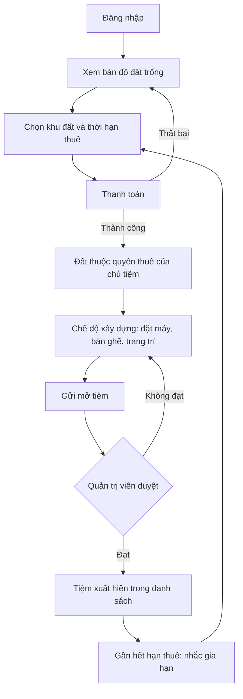
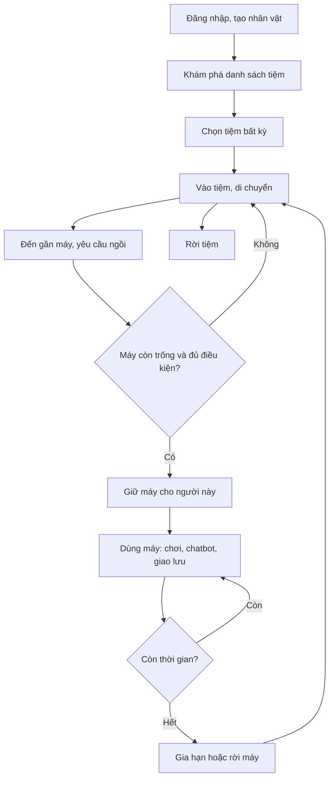
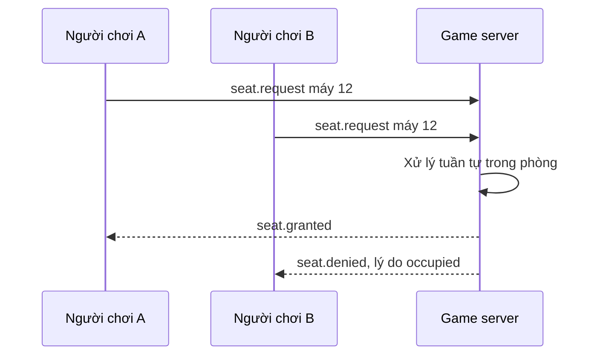
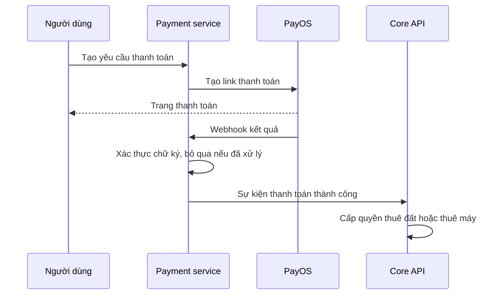

# Luồng nghiệp vụ

Các luồng dưới đây mô tả hành vi mong muốn. Điểm chưa chốt được đánh dấu và có trong [câu hỏi mở](../open-questions.md).

## Chủ tiệm mở tiệm

Liên quan: REQ-009, REQ-010, REQ-013, REQ-015, REQ-016.

Chưa chốt: thuê đất trả bằng tiền thật hay đơn vị trong game; hết hạn thuê thì tiệm xử lý ra sao.

## Người chơi đi net

Liên quan: REQ-001, REQ-003, REQ-011, REQ-014, REQ-017, REQ-018, REQ-020.

## Giữ máy khi nhiều người tranh

Liên quan: REQ-018. Đây là quy tắc không được hỏng: một máy chỉ có một người dùng tại một thời điểm.

## Thanh toán

Liên quan: REQ-010, REQ-012. Webhook có thể đến nhiều lần hoặc không theo thứ tự.

