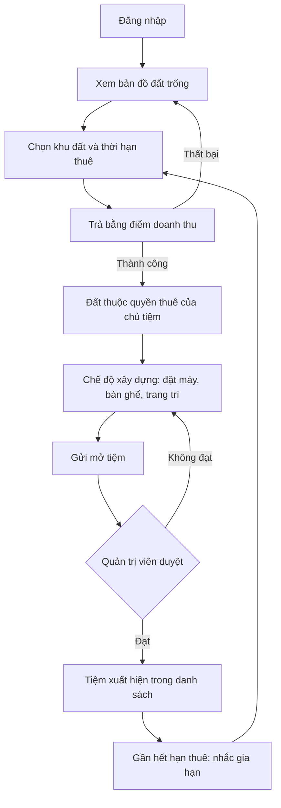
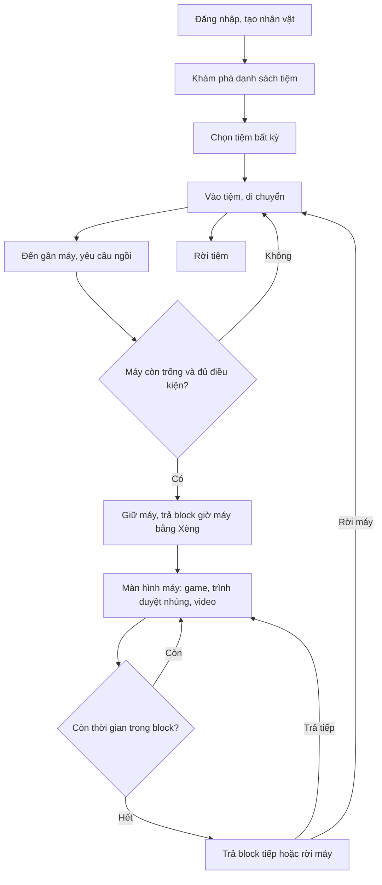
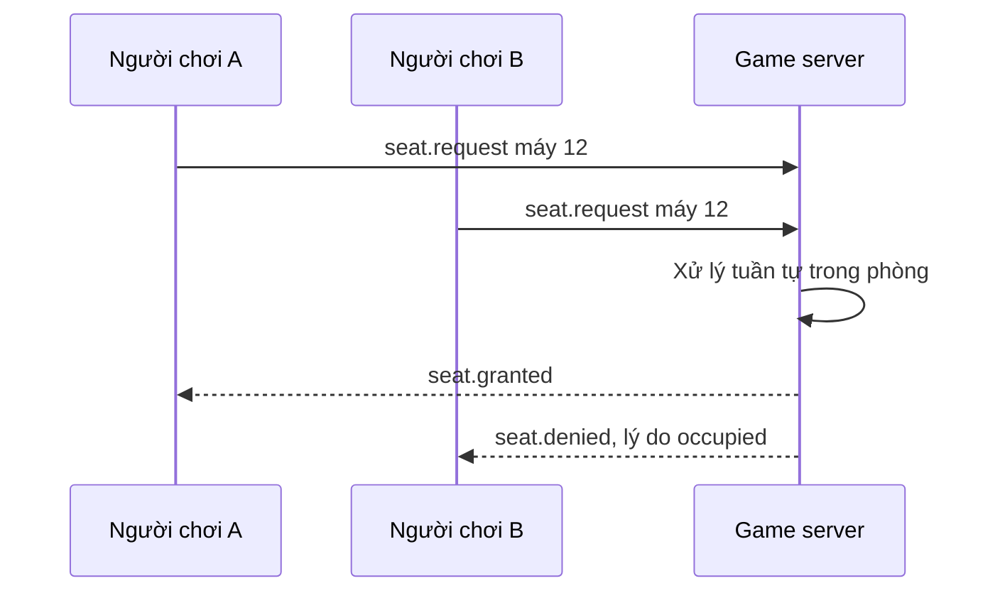
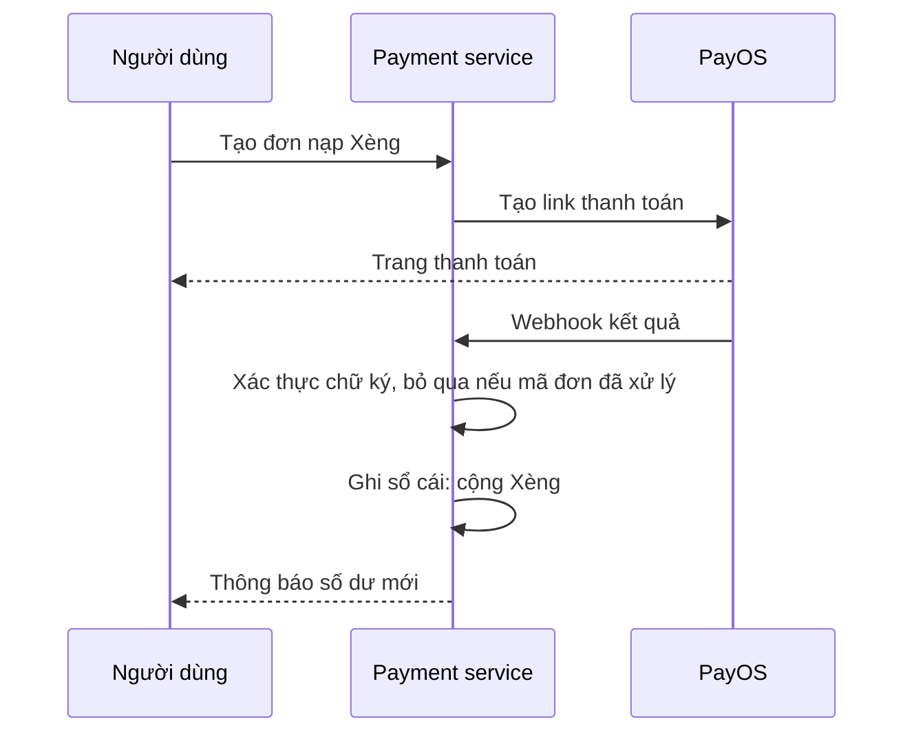
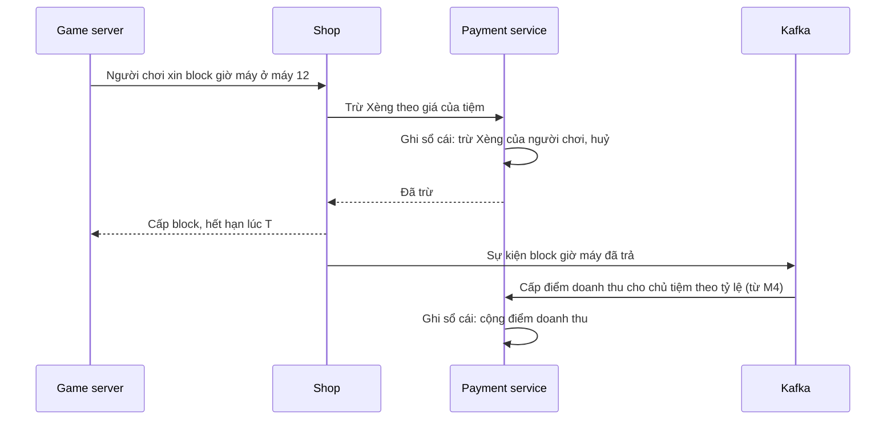

# Luồng nghiệp vụ

Các luồng dưới đây mô tả hành vi mong muốn. Điểm chưa chốt được đánh dấu và có trong [câu hỏi mở](../open-questions.md).

## Chủ tiệm mở tiệm

Liên quan: REQ-009, REQ-010, REQ-013, REQ-015, REQ-016.

Hướng tạm theo [ADR-0010](../../decisions/ADR-0010-one-way-virtual-currency.md): thuê đất trả bằng điểm doanh thu. Chưa chốt:

- Chủ tiệm mới chưa có điểm thì thuê khu đất đầu tiên bằng gì.
- Hết hạn thuê khi tiệm đang có người thì xử lý ra sao.

## Người chơi đi net

Liên quan: REQ-001, REQ-003, REQ-011, REQ-014, REQ-017, REQ-018, REQ-020, REQ-032, REQ-033, REQ-036.

## Giữ máy khi nhiều người tranh

Liên quan: REQ-018. Đây là quy tắc không được hỏng: một máy chỉ có một người dùng tại một thời điểm.

## Nạp Xèng

Liên quan: REQ-010, REQ-012, REQ-028, REQ-029. Webhook có thể đến nhiều lần hoặc không theo thứ tự. PayOS chỉ dùng để nạp; không có luồng rút.

## Trả giờ máy và cấp điểm doanh thu

Liên quan: REQ-011, REQ-029, REQ-030. Xèng của người chơi không bao giờ vào ví chủ tiệm. Trừ Xèng là gọi đồng bộ vì phải biết kết quả trước khi cấp block; cấp điểm doanh thu đi qua sự kiện và có từ M4.

