# Ảnh đích cho thành phố

Mỗi ảnh dưới đây là đích để đối chiếu khi làm một việc trong [đợt dựng thành phố](https://github.com/netverse3d/netverse3d/issues/231). Bảng tiêu chí đi kèm nằm ở [issue 258](https://github.com/netverse3d/netverse3d/issues/258).

## Đọc ảnh thế nào

**Ảnh chỉ mang tính định hướng. Làm ra y chang ảnh là không đạt.** Mỗi món phải có thiết kế riêng và chi tiết hơn hẳn mức khối trong ảnh.

- Ảnh do nhóm tự dựng bằng khối đơn giản trong Blender và kết xuất ngoại tuyến. Không có ảnh nào lấy từ nguồn ngoài.
- Ảnh là đích về ánh sáng, bố cục, tỉ lệ và không khí. Ảnh chưa phải đích về độ chi tiết: mô hình thật phải vượt mức khối trong ảnh theo các tiêu chí hình khối và vật liệu.
- Game chạy thời gian thực nên không cần giống từng điểm ảnh. Việc đạt khi người xem đặt hai ảnh cạnh nhau và thấy cùng một không khí.
- Công trình trong ảnh chỉ gợi hình theo ADR-0014 và không mang tên thật.

## Ảnh theo việc

### Bầu trời, sương và chiều sâu

Việc: [issue 235](https://github.com/netverse3d/netverse3d/issues/235). Ba lớp gần, giữa, xa tách nhau; tháp nhạt dần vào màu trời; quầng sáng quanh đèn đường.

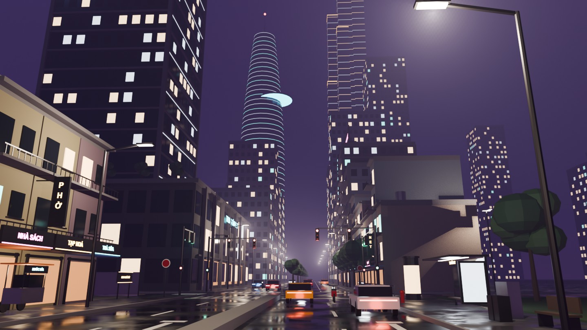

### Thang phát sáng của neon và cửa sổ

Việc: [issue 236](https://github.com/netverse3d/netverse3d/issues/236). Nền tối, mỗi biển một màu và đọc được chữ; neon in vệt xuống mặt đường ướt.

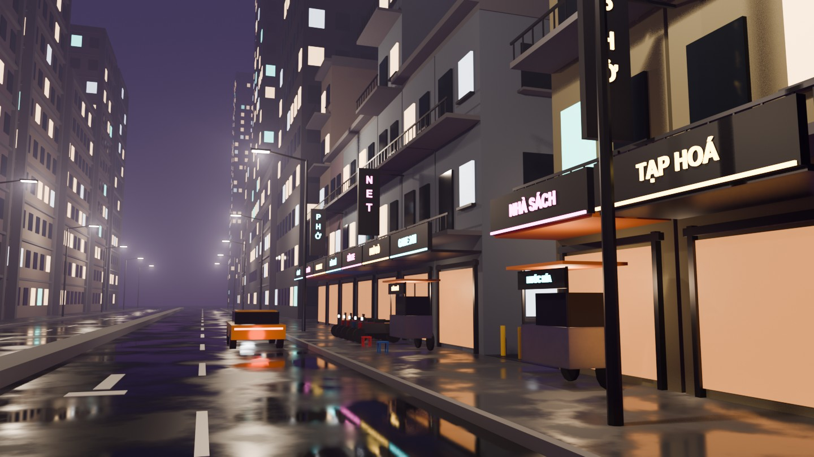

### Mưa đêm

Việc: [issue 259](https://github.com/netverse3d/netverse3d/issues/259). Hạt mưa xiên bắt sáng, vũng nước loang không đều, đèn tín hiệu và đèn xe kéo vệt trên mặt đường.

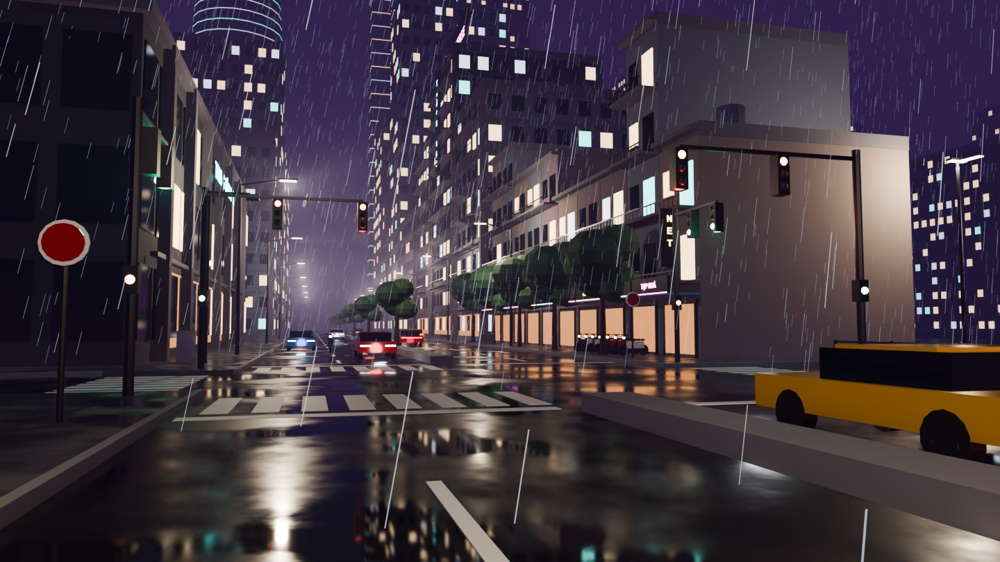

### Đường chân trời

Việc: [issue 186](https://github.com/netverse3d/netverse3d/issues/186). Hai tháp cao làm điểm tựa, các khối thấp dần, cửa sổ sáng không đều, tất cả ngả về màu trời.

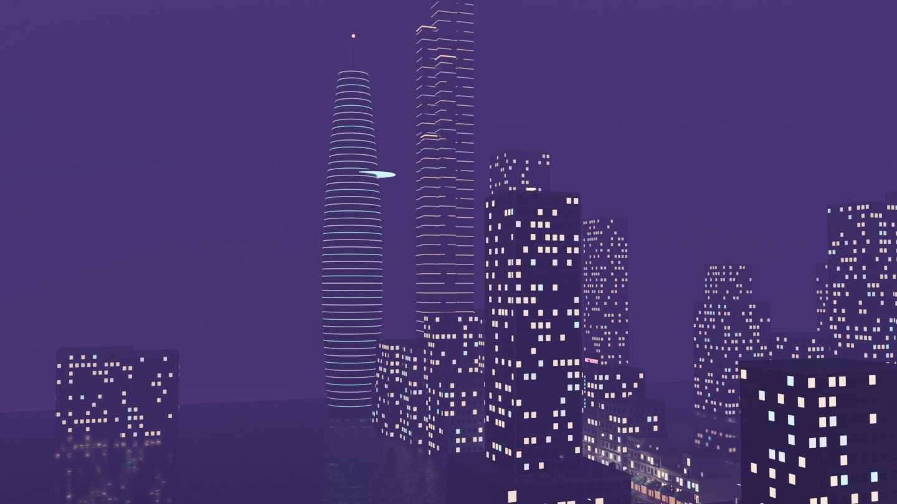

### Biển neon cỡ lớn

Việc: [issue 220](https://github.com/netverse3d/netverse3d/issues/220). Biển nóc nhà trên khung đỡ và biển dọc chạy theo mặt đứng, đọc được từ bên kia đường.

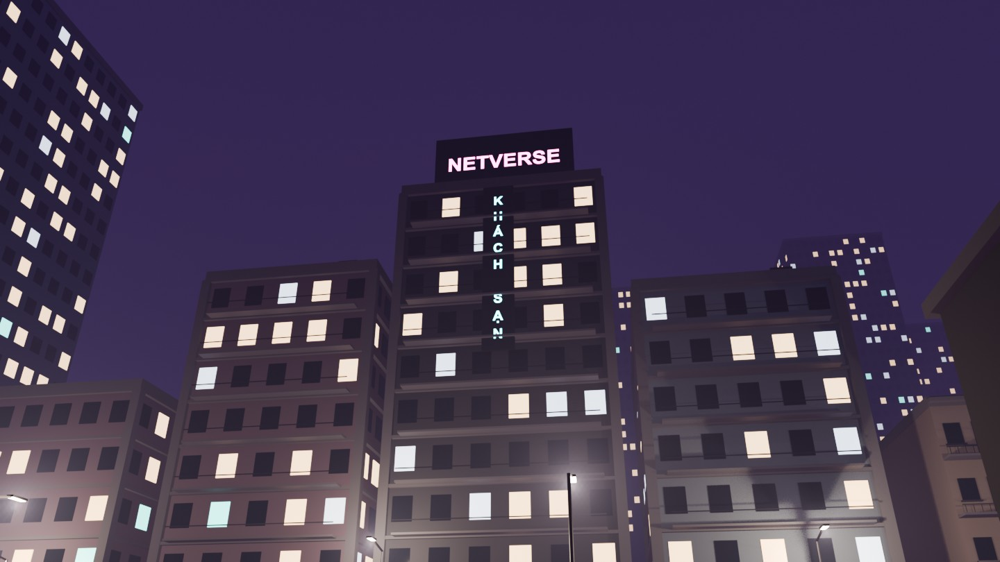

### Dây đèn và đèn lồng trong hẻm

Việc: [issue 221](https://github.com/netverse3d/netverse3d/issues/221). Dây đèn nối hai bên hẻm lặp theo nhịp dẫn mắt vào sâu, ánh ấm trên nền lạnh.

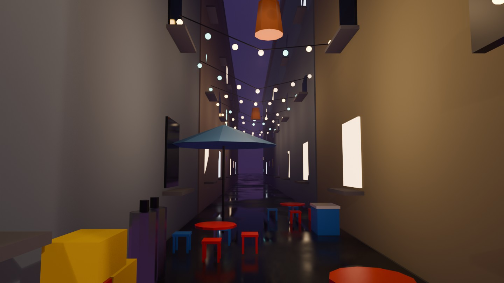

### Chung cư và nhà văn phòng

Việc: [issue 252](https://github.com/netverse3d/netverse3d/issues/252). Ba toà khác nhau về chiều cao và nhịp cửa sổ, có ban công và gờ tầng, tầng trệt sáng.

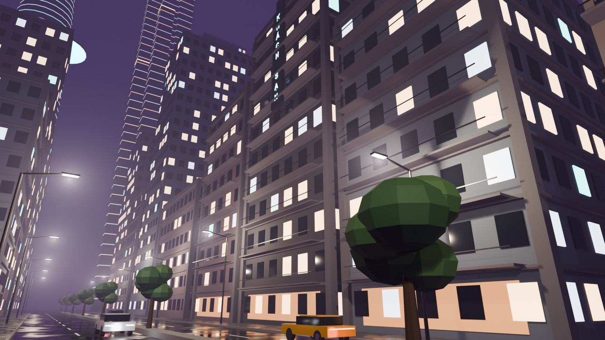

### Hai tháp điểm nhấn

Việc: [issue 253](https://github.com/netverse3d/netverse3d/issues/253). Đọc ra chỉ bằng dáng: một tháp thuôn có sàn nhô, một tháp nhiều khối bậc thang có chóp.

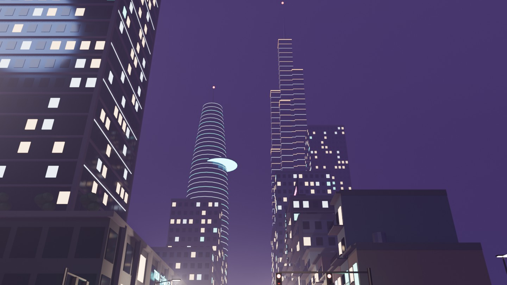

### Công viên

Việc: [issue 255](https://github.com/netverse3d/netverse3d/issues/255). Khoảng tối có chủ ý, đèn thấp ấm theo lối đi, đài phun là điểm sáng lạnh duy nhất.

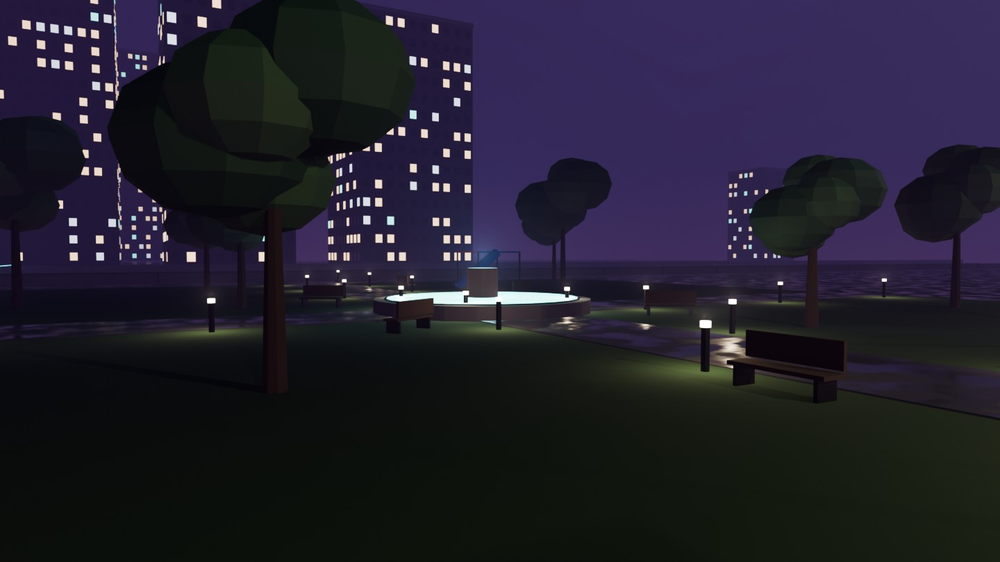

### Xe trên đường

Việc: [issue 183](https://github.com/netverse3d/netverse3d/issues/183). Đèn hậu là dải phát sáng có quầng, thân xe phản chiếu xuống mặt đường, tỉ lệ khớp với làn.

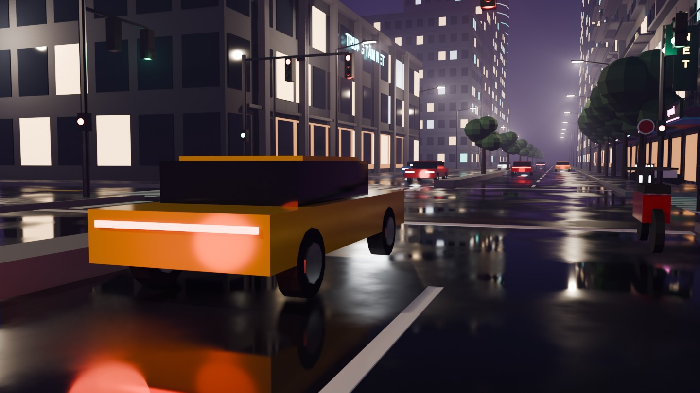

### Xe hàng rong

Việc: [issue 222](https://github.com/netverse3d/netverse3d/issues/222). Xe đứng sát mặt tiền, có mái che, biển tên phát sáng và đèn ấm của riêng nó.

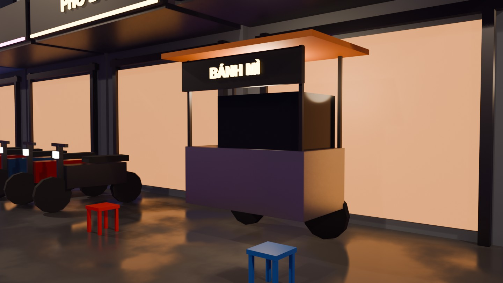

### Quán cà phê vỉa hè

Việc: [issue 223](https://github.com/netverse3d/netverse3d/issues/223). Bàn ghế nhựa tụ thành cụm, màu nóng nổi trên nền tối, thùng đá và dù che.

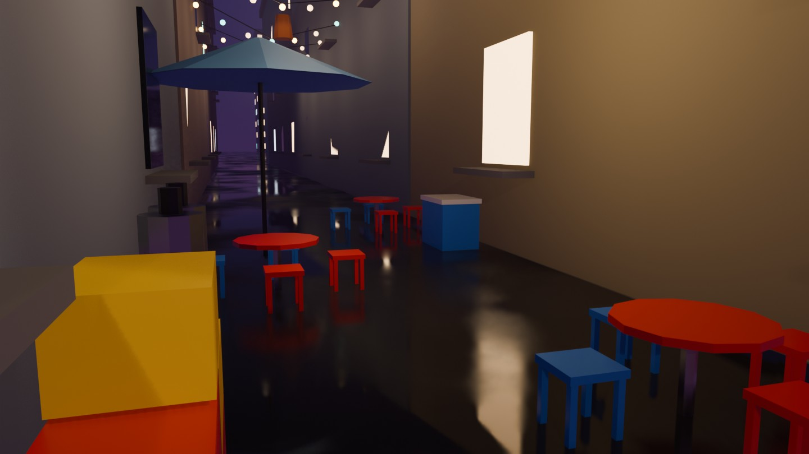

### Đèn tín hiệu và đèn đường

Việc: [issue 249](https://github.com/netverse3d/netverse3d/issues/249). Trụ có cần vươn ra giữa đường, từng bóng đèn là một nguồn sáng riêng, đèn đường cao theo nhịp.

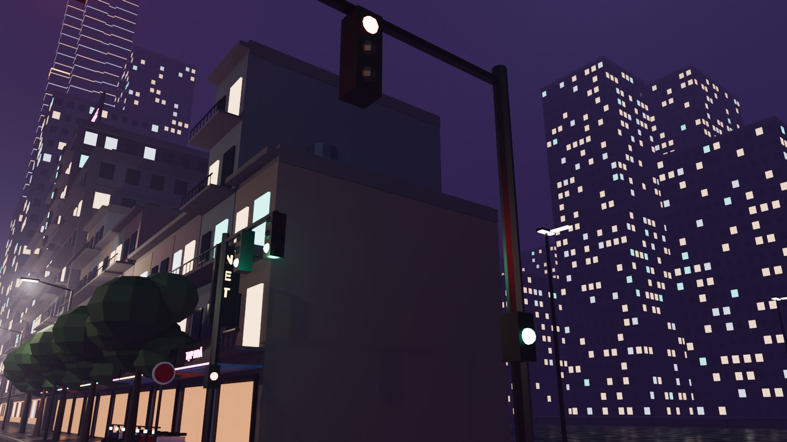

### Tiện ích phố lớn

Việc: [issue 250](https://github.com/netverse3d/netverse3d/issues/250). Trạm chờ có mái và bảng sáng, trụ quảng cáo, tủ điện, thùng rác tụ thành một cụm trên vỉa hè.

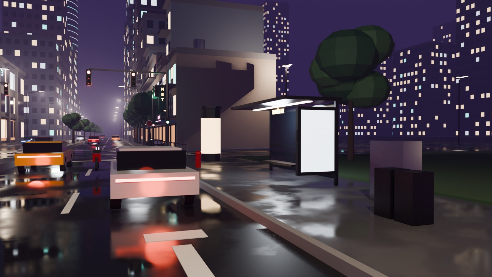

### Sông và cầu

Việc: [issue 254](https://github.com/netverse3d/netverse3d/issues/254). Cầu dây văng một trụ nghiêng với dây cáp sáng, mặt nước phản chiếu thành phố.

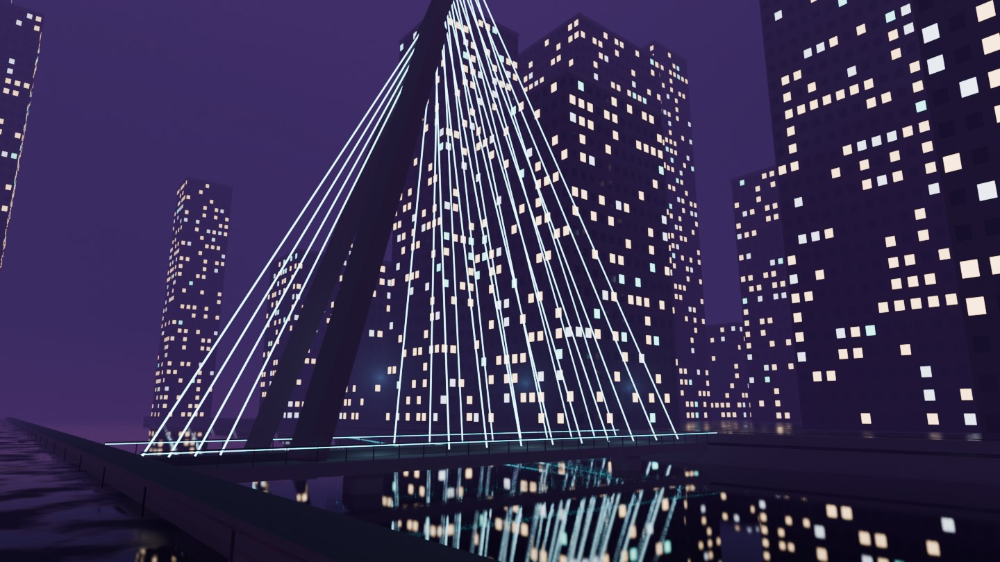

### Đường lớn

Việc: [issue 247](https://github.com/netverse3d/netverse3d/issues/247). Hai chiều tách bằng dải phân cách, vạch làn đứt, mũi tên, mặt đường ướt loang.

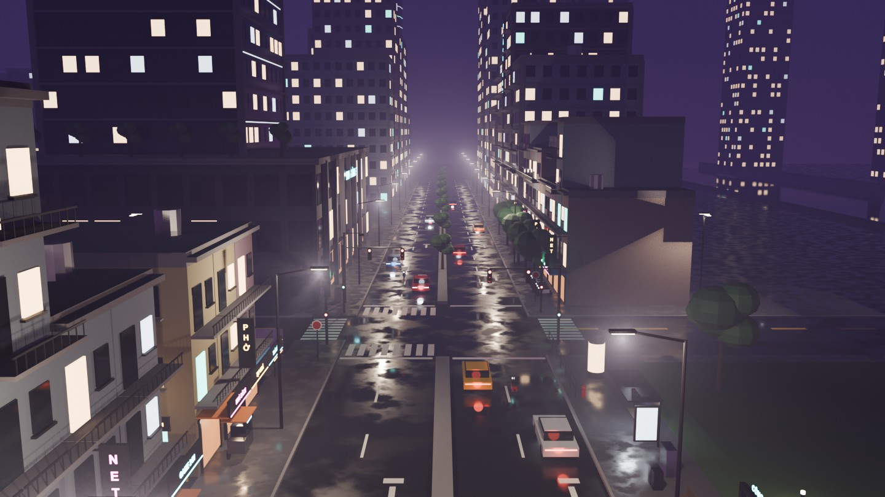

### Nút giao

Việc: [issue 248](https://github.com/netverse3d/netverse3d/issues/248). Vạch qua đường ở cả bốn nhánh, vạch dừng, góc vỉa hè, đèn tín hiệu ở mỗi góc.

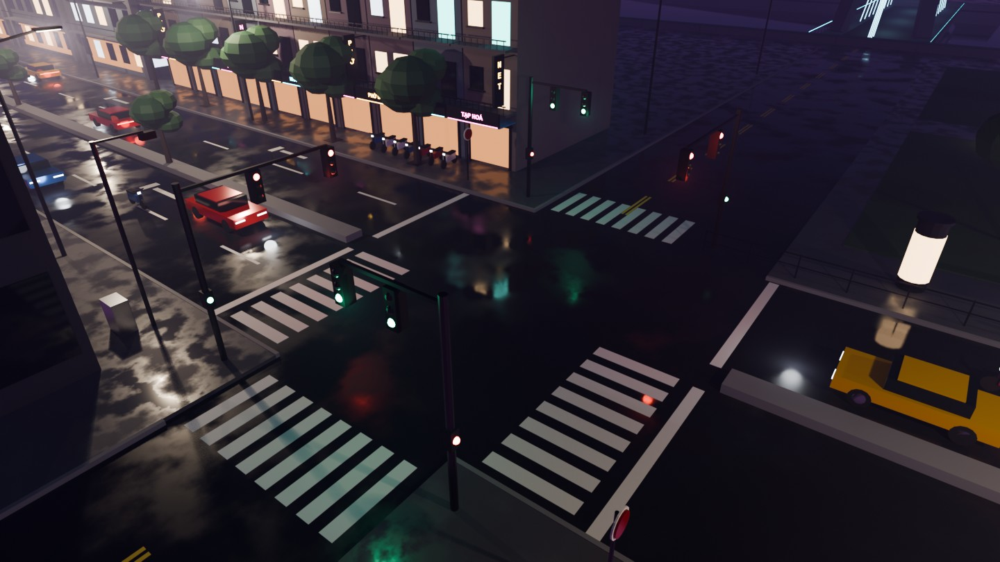

### Cây đường phố

Việc: [issue 224](https://github.com/netverse3d/netverse3d/issues/224). Hàng cây theo nhịp trên vỉa hè, tán đọc ra từ xa, không che biển hiệu.

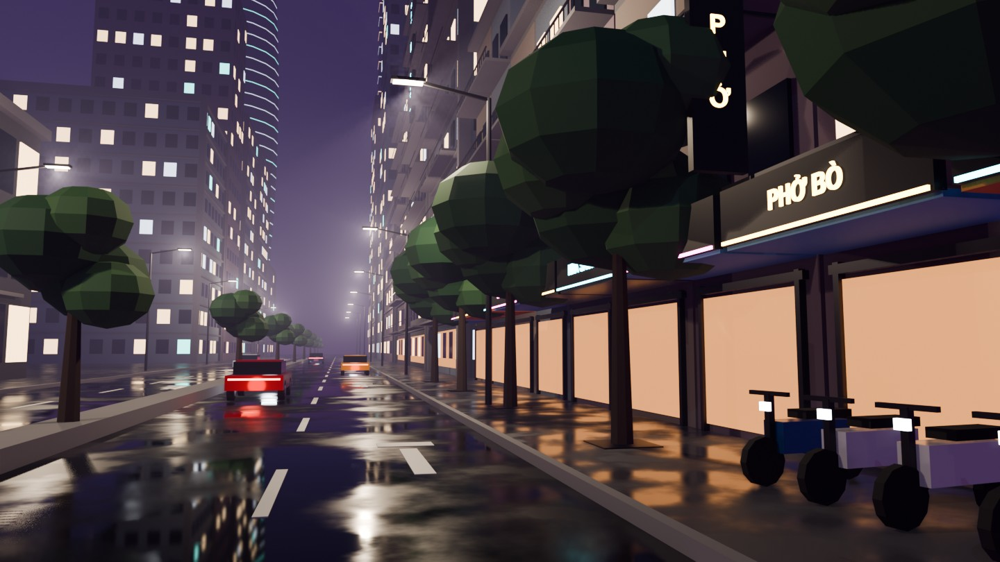

### Lô đất trống

Việc: [issue 225](https://github.com/netverse3d/netverse3d/issues/225). Hàng rào quanh lô, bảng báo có viền sáng đọc được từ ngoài đường.

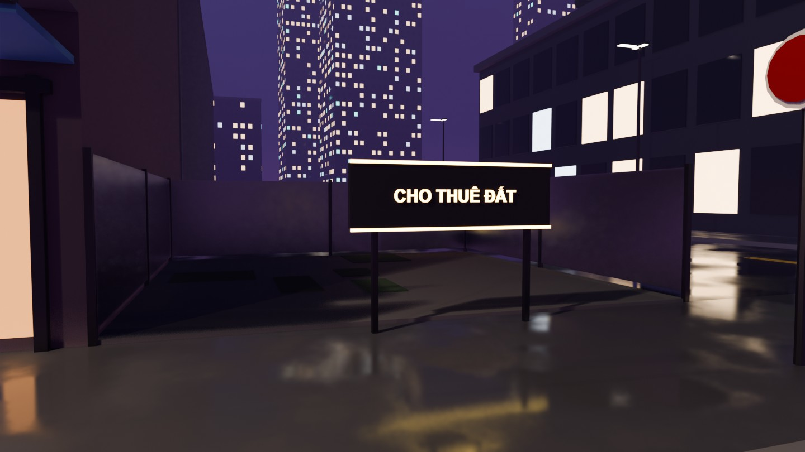

### Đồ lặt vặt trong hẻm

Việc: [issue 226](https://github.com/netverse3d/netverse3d/issues/226). Cọc chắn, trụ nước, két nhựa, bình gas tụ ở miệng hẻm và chân tường.

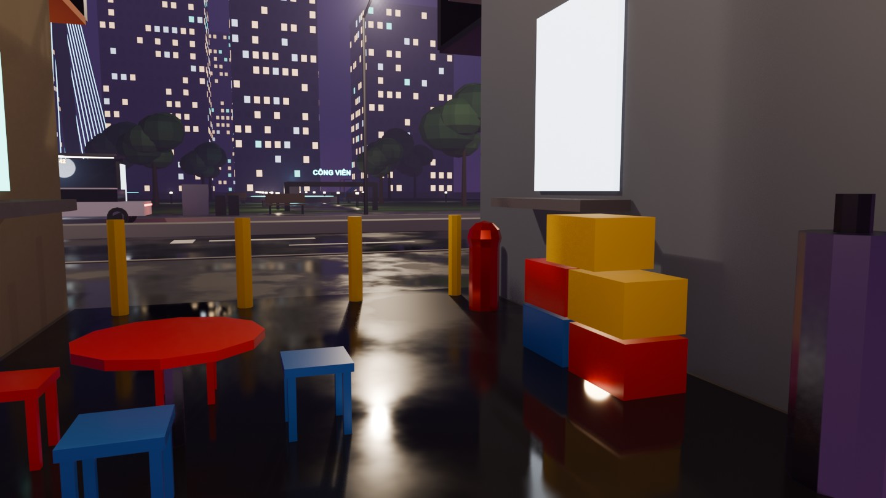
