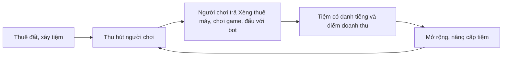
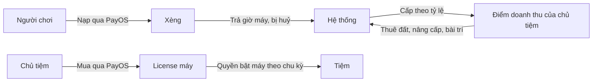

# Tổng quan sản phẩm

Netverse 3D là thế giới tiệm net 3D chạy trên trình duyệt. Một người có thể vừa là chủ tiệm, vừa là người đi chơi net.

## Hướng đang đề xuất

Theo [ADR-0014](../../decisions/ADR-0014-saigon-cyber-and-own-characters.md), đang ở mức đề xuất:

- Thể loại nghiêng về tycoon mở tiệm net. Trọng tâm là cả game lẫn ứng dụng AI.
- Khách trong tiệm có thể là người thật hoặc bot, nên tiệm vẫn có sức sống khi vắng người. Chiếc máy trong tiệm là cửa vào web, game và các trận đấu với bot.
- Thế giới là hẻm, nhà ống, biển hiệu tiếng Việt của Sài Gòn dưới ánh đèn đêm. Đồ vật tối và trầm, màu đến từ ánh đèn.
- Nhân vật người là chibi do nhóm tự thiết kế, tự chọn đồ và màu từng phần, có mười hai biểu cảm khi chơi.
- Bot là một dòng robot cùng dáng với người chơi, nhận ra qua mặt kính đen và mắt LED.

## Người dùng

| Vai trò       | Muốn gì                                | Làm gì trong hệ thống                                           |
| ------------- | -------------------------------------- | --------------------------------------------------------------- |
| Chủ tiệm      | Có tiệm đẹp, đông khách, có danh tiếng | Thuê đất, xây và bài trí tiệm, đặt máy, nâng cấp                |
| Người chơi    | Có chỗ chơi, gặp bạn bè                | Tạo nhân vật, chọn tiệm, thuê máy, chơi game trên máy, giao lưu |
| Quản trị viên | Hệ thống ổn định, nội dung lành mạnh   | Quản lý người dùng, duyệt tiệm, xem thống kê                    |

## Vòng lặp sản phẩm

## Kinh tế (hướng tạm)

Theo [ADR-0010](../../decisions/ADR-0010-one-way-virtual-currency.md), đang ở mức đề xuất, và [ADR-0021](../../decisions/ADR-0021-two-real-money-flows.md):

- Người chơi nạp tiền thật để có **Xèng** (tên tạm). Xèng chỉ tiêu trong Netverse, không rút, không chuyển cho người khác.
- Xèng trả cho giờ máy bị huỷ. Hệ thống cấp **điểm doanh thu** cho chủ tiệm, chỉ dùng để thuê đất, nâng cấp và bài trí tiệm.
- Chủ tiệm trả tiền thật để mua **license máy**: quyền bật một số máy của tiệm trong một chu kỳ. License không tạo ra Xèng hay điểm doanh thu.
- Tiệm vắng có bot khách. Chỉ tiệm mới nhận điểm từ bot khách, có trần và thấp hơn nhiều so với khách thật.

## Phạm vi theo giai đoạn

Theo [ADR-0002](../../decisions/ADR-0002-product-scope.md), phần học tăng cường đang được xem lại ở [ADR-0012](../../decisions/ADR-0012-games-for-rl-bots.md):

1. **Sản phẩm chính:** thuê đất, xây tiệm, người chơi vào máy, chơi game trên máy, giao lưu.
2. **Sau đó:** bot học tăng cường chơi game trên máy cùng người.
3. **Sau nữa:** chatbot LLM, đọc hội thoại bằng tiếng Việt và NPC phục vụ.

Thứ tự chi tiết ở [lộ trình](../team/roadmap.md).

Trước mắt nhóm làm giao diện và identity, rồi tới lát cắt đầu: tiệm dựng sẵn, màn hình máy và game đầu tiên trên room server giả. Sau đó tới Xèng, payment và notification. Game core do mentor làm, xem [ADR-0004](../../decisions/ADR-0004-game-core-boundary.md).

## Đọc tiếp

- [Luồng nghiệp vụ](./business-flows.md)
- [Sổ yêu cầu](../../requirements/index.md)
- [Câu hỏi mở](../open-questions.md)
