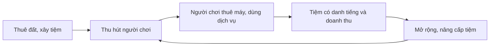

# Tổng quan sản phẩm

Netverse 3D là thế giới tiệm net 3D chạy trên trình duyệt. Một người có thể vừa là chủ tiệm, vừa là người đi chơi net.

## Người dùng

| Vai trò       | Muốn gì                                | Làm gì trong hệ thống                            |
| ------------- | -------------------------------------- | ------------------------------------------------ |
| Chủ tiệm      | Có tiệm đẹp, đông khách, có danh tiếng | Thuê đất, xây và bài trí tiệm, đặt máy, nâng cấp |
| Người chơi    | Có chỗ chơi, gặp bạn bè                | Tạo nhân vật, chọn tiệm, thuê máy, giao lưu      |
| Quản trị viên | Hệ thống ổn định, nội dung lành mạnh   | Quản lý người dùng, duyệt tiệm, xem thống kê     |

## Vòng lặp sản phẩm

## Phạm vi theo giai đoạn

Theo [ADR-0002](../../decisions/ADR-0002-product-scope.md):

1. **Sản phẩm chính:** thuê đất, xây tiệm, người chơi vào máy, giao lưu.
2. **Sau đó:** chatbot LLM và đọc hội thoại bằng tiếng Việt.
3. **Sau nữa:** NPC phục vụ huấn luyện bằng học tăng cường.

Trước mắt nhóm tập trung vào giao diện, identity, media, payment, notification. Game core do mentor làm, xem [ADR-0004](../../decisions/ADR-0004-game-core-boundary.md).

## Đọc tiếp

- [Luồng nghiệp vụ](./business-flows.md)
- [Sổ yêu cầu](../../requirements/index.md)
- [Câu hỏi mở](../open-questions.md)
