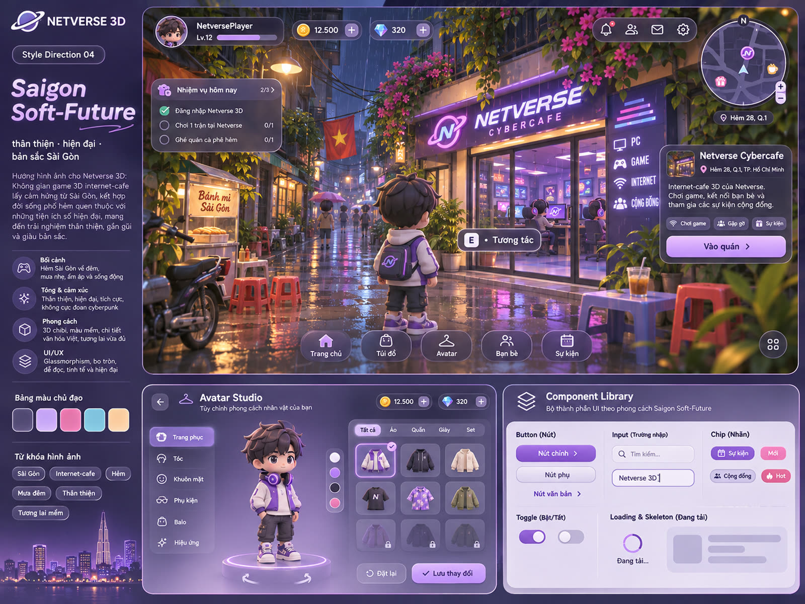

# Tiêu chí giao diện

Trang này quy định các tiêu chí cho mọi màn hình 2D của Netverse 3D theo [REQ-052](../../requirements/registry.yaml) và [ADR-0040](../../decisions/ADR-0040-saigon-soft-future-ui.md): HUD, hộp thoại, màn tài khoản, gợi ý tương tác, màn tạo nhân vật, màn hình máy, trang quản trị. Cách dùng token và component để đạt các tiêu chí này nằm ở [hệ thiết kế giao diện](../engineering/design-system.md). Thế giới và nhân vật 3D theo [tiêu chí mỹ thuật](./art-criteria.md), không theo trang này.

> **Quy định xét duyệt:** Bảng tiêu chí do người dẫn dắt nhóm phê duyệt. Thêm, sửa hay bỏ một tiêu chí thì sửa trang này bằng pull request, không sửa rải rác trong issue.

## Ảnh định hướng

> **Ảnh chỉ định hướng. Làm ra giống hệt ảnh là không đạt.** Ảnh do người dẫn dắt nhóm tạo bằng công cụ sinh ảnh để chốt cảm giác, bảng màu và bố cục; không phải bản thiết kế.

Đọc ảnh theo ADR-0040:

- Lấy: cảm giác thân thiện, hiện đại, bản sắc Sài Gòn; nền panel tối trong suốt nhẹ; bo tròn; tím làm màu nhấn cùng hồng, xanh da trời nhạt, cam đào; nhãn chữ rõ cạnh biểu tượng; gợi ý phím nổi ngay cạnh vật tương tác.
- Không lấy: nền panel sáng của khu Avatar Studio và Component Library (giao diện tối ở mọi nơi); đồng tiền kim cương (trái REQ-028, ADR-0010, ADR-0033); mỹ thuật 3D của cảnh và nhân vật (thuộc ADR-0014).
- Biểu tượng chuông và thư ứng với hộp thư thông báo đã có theo REQ-008. Bạn bè thuộc REQ-020.
- Nhiệm vụ hằng ngày, bản đồ nhỏ, thư giữa người chơi, túi đồ, món đồ khoá, cấp độ người chơi và sự kiện cộng đồng chưa có yêu cầu chốt; xem REQ-053 tới REQ-059. Không làm khi các REQ đó còn nháp.

## Đọc bảng thế nào

Mỗi tiêu chí ghi kết quả người dùng nhìn thấy hoặc làm được, kèm cách kiểm:

- **Test:** có test chạy trong `pnpm verify`; cột ghi tên ca test và issue sẽ thêm nó.
- **Thư viện:** người duyệt xem trong Thư viện giao diện ở mọi trạng thái của component.
- **Chạy thử:** người duyệt chơi thử trên `pnpm --filter @netverse/web-3d dev`, hoặc trên trang quản trị khi màn đó thuộc quản trị.
- **Duyệt mã:** người duyệt đọc diff theo luật đã ghi ở wiki; chưa có công cụ chặn.

Tiêu chí nào chuyển được từ duyệt sang test thì chuyển, và sửa cột cách kiểm trong cùng PR.

## Bảng tiêu chí

### N. Ngữ nghĩa và màu

| Mã     | Tiêu chí                                                                                                        | Cách kiểm                                                                     |
| :----- | :-------------------------------------------------------------------------------------------------------------- | :---------------------------------------------------------------------------- |
| **N1** | Component không ghi mã màu, cỡ chữ, khoảng cách hay thời lượng; chỉ dùng token ngữ nghĩa hoặc token thành phần. | Test "component không ghi giá trị trực tiếp và chỉ dùng biến đã khai" (#417). |
| **N2** | Màu riêng của tiệm chỉ đổi màu nhấn. Chữ, viền focus và màu trạng thái giữ nguyên với mọi tiệm.                 | Test "đổi accent tiệm không đổi màu trạng thái lỗi" (#417).                   |
| **N3** | Trạng thái không chỉ nói bằng màu: lỗi, cảnh báo, thành công luôn có chữ hoặc biểu tượng đi kèm.                | Thư viện.                                                                     |
| **N4** | Nền panel tối ở mọi màn, kể cả màn toàn trang.                                                                  | Thư viện, chạy thử.                                                           |

### T. Tương tác

| Mã     | Tiêu chí                                                                                                                                                | Cách kiểm                                                                                                                                         |
| :----- | :------------------------------------------------------------------------------------------------------------------------------------------------------ | :------------------------------------------------------------------------------------------------------------------------------------------------ |
| **T1** | Mỗi vùng thao tác có đúng một hành động chính nổi bật; các hành động khác ở mức phụ.                                                                    | Thư viện, chạy thử.                                                                                                                               |
| **T2** | Mọi nút có nhãn đọc được. Nút chỉ có biểu tượng vẫn có nhãn cho trình đọc màn hình.                                                                     | Thư viện.                                                                                                                                         |
| **T3** | Đang chờ kết quả thì không gửi thêm cùng một lệnh, dù bấm đúp hay giữ phím; nút báo bận trong lúc chờ.                                                  | Test "nút đang chờ không nhận lệnh và báo bận cho trình đọc màn hình" (#418); test "nhấn E hai lần khi đang chờ chỉ gửi một yêu cầu ngồi" (#419). |
| **T4** | Giao diện chỉ báo thành công khi phòng hoặc server đã xác nhận. Giữ chỗ máy vẫn do phòng bảo đảm theo REQ-018, giao dịch Xèng theo REQ-028 và ADR-0010. | Test "chỉ phòng mới đặt được trạng thái đã ngồi" (#419); smoke "nút ngồi báo bận trong lúc chờ phòng xác nhận" (#419).                            |
| **T5** | Hộp thoại thường đóng bằng Escape và trả focus về chỗ cũ; hộp thoại đang xử lý giao dịch không đóng bằng Escape.                                        | Test "hộp thoại đang xử lý không đóng bằng Escape" (#418); smoke "hộp đăng nhập giữ focus và đóng bằng Escape" (#418).                            |

### P. Phản hồi và tải

| Mã     | Tiêu chí                                                                                                 | Cách kiểm                                                               |
| :----- | :------------------------------------------------------------------------------------------------------- | :---------------------------------------------------------------------- |
| **P1** | Không có tiến độ thật thì không hiện phần trăm; dùng trạng thái chờ không xác định.                      | Test "spinner không hiện phần trăm khi không có tiến độ thật" (#418).   |
| **P2** | Skeleton giữ đúng khung của nội dung sắp tới; nội dung về không làm nhảy bố cục.                         | Thư viện.                                                               |
| **P3** | Lỗi hiện ngay tại chỗ gây lỗi, nói lý do và bước tiếp theo, ví dụ thiếu Xèng thì chỉ tới chỗ nạp.        | Thư viện, chạy thử.                                                     |
| **P4** | Thông báo nhanh không cắt ngang lúc chơi, không lấy focus, tự ẩn.                                        | Thư viện, chạy thử.                                                     |
| **P5** | Phản hồi về một vật trong thế giới hiện ngay cạnh vật đó, ví dụ máy đã có người; không mở hộp thoại lớn. | Chạy thử.                                                               |
| **P6** | Mất WebGL thì hiện lớp khôi phục, tài khoản vẫn đăng nhập, cảnh tự quay lại.                             | Smoke "mất WebGL hiện lớp khôi phục và tài khoản vẫn đăng nhập" (#419). |

### K. Khả dụng

| Mã     | Tiêu chí                                                                   | Cách kiểm                                                                         |
| :----- | :------------------------------------------------------------------------- | :-------------------------------------------------------------------------------- |
| **K1** | Chữ trên mọi mặt nền đạt tương phản 4.5:1.                                 | Test "chữ chính trên mọi mặt nền đạt tương phản 4.5:1" (#417).                    |
| **K2** | Viền focus, viền điều khiển và màu trạng thái đạt 3:1 trên mặt nền.        | Test "viền focus, viền điều khiển và màu trạng thái đạt 3:1 trên mặt nền" (#417). |
| **K3** | Mọi thao tác làm được bằng bàn phím; phần tử đang focus luôn thấy rõ.      | Thư viện, chạy thử.                                                               |
| **K4** | Trên điện thoại, vùng chạm của mọi nút và ô chọn không nhỏ hơn 44 × 44 px. | Thư viện ở khổ điện thoại.                                                        |
| **K5** | Chữ hiển thị nằm trong tệp ngôn ngữ, không nằm trong component.            | Duyệt mã theo luật ở [wiki client game](../engineering/web-client.md).            |

### L. Lớp hiển thị

| Mã     | Tiêu chí                                                                                                                                     | Cách kiểm                                                                     |
| :----- | :------------------------------------------------------------------------------------------------------------------------------------------- | :---------------------------------------------------------------------------- |
| **L1** | Thứ tự lớp cố định từ dưới lên: canvas, gợi ý trong thế giới, HUD, thông báo nhanh, hộp thoại, lớp khôi phục. Component không tự đặt số lớp. | Test "component không ghi giá trị trực tiếp và chỉ dùng biến đã khai" (#417). |
| **L2** | Mọi hộp thoại nằm trên HUD; HUD không che lớp khôi phục; gợi ý tương tác không che vật đang tương tác.                                       | Chạy thử.                                                                     |

### H. Hiệu năng và chuyển động

| Mã     | Tiêu chí                                                                                                              | Cách kiểm                                                                      |
| :----- | :-------------------------------------------------------------------------------------------------------------------- | :----------------------------------------------------------------------------- |
| **H1** | Ở mức chất lượng thấp, hoặc khi hệ điều hành báo người dùng chọn giảm trong suốt, mọi panel kính chuyển sang nền đặc. | Test "mức chất lượng thấp hoặc giảm trong suốt dùng nền đặc thay kính" (#417). |
| **H2** | Khi hệ điều hành báo người dùng chọn giảm chuyển động, mọi thời lượng chuyển động về 0.                               | Test "khi người dùng chọn giảm chuyển động, mọi thời lượng về 0" (#417).       |
| **H3** | Kính mờ chỉ dùng cho panel cần cảm giác không gian, không phủ toàn bộ HUD.                                            | Thư viện.                                                                      |
| **H4** | Chuyển động không chặn thao tác, không làm mất focus, không làm nhảy bố cục.                                          | Thư viện, chạy thử.                                                            |

## Bảng kiểm duyệt component

Dùng khi thêm hoặc sửa một component trong `packages/ui` hay `apps/web-3d/src/ui/`:

- [ ] Component có mặt trong Thư viện giao diện với đủ trạng thái áp dụng: thường, hover, focus, chờ, tắt, lỗi. Component của `packages/ui` có test giữ điều này (#418); component riêng của game đưa vào mục Mẫu tương tác và duyệt bằng mắt.
- [ ] **N1**, **L1**: không có mã màu, cỡ, khoảng cách, số lớp, thời lượng viết thẳng; test quét xanh.
- [ ] **N2**, **K1**, **K2**: xem với ít nhất hai bộ màu tiệm; test tương phản xanh.
- [ ] **N3**, **T2**: trạng thái có chữ hoặc biểu tượng; nút có nhãn.
- [ ] **T1**: vùng thao tác có đúng một hành động chính.
- [ ] **T3**, **T5**: có trạng thái chờ nếu component gửi lệnh; hộp thoại đóng đúng luật.
- [ ] **K3**, **K4**: dùng được bằng bàn phím; vùng chạm đủ lớn ở khổ điện thoại.
- [ ] **H1**, **H2**, **H4**: xem ở mức chất lượng thấp và khi bật giảm chuyển động.
- [ ] Ảnh chụp từng trạng thái trong PR.
