# Luồng làm việc

```mermaid
flowchart LR
  A[REQ trong sổ yêu cầu] --> B[Issue trong Project]
  B --> C[Nhánh từ staging]
  C --> D[Code và test]
  D --> E[PR vào staging]
  E --> F[CI và một thành viên duyệt]
  F --> G[Squash vào staging]
  G --> H[Release staging và test]
  H --> I[Promote lên main]
  I --> J[Release production]
```

## Từng bước

1. **Chọn issue.** Chưa có issue thì tạo mới từ mẫu. Issue phải gắn REQ và có đủ thông tin theo [hướng dẫn đóng góp](https://github.com/netverse3d/netverse3d/blob/staging/CONTRIBUTING.md).
2. **Nhận việc:** tự gán Assignees, điền Start date và Target date, chuyển Status sang `Ready`.
3. **Tạo nhánh** từ `staging`: `feat/<issue>-<slug>`.
4. **Liên kết yêu cầu:** `pnpm trace:link REQ-001`.
5. **Làm việc:** commit nhỏ, viết test, cập nhật wiki nếu hành vi đổi.
6. **Kiểm tra:** `pnpm verify`.
7. **Mở PR** vào `staging`, mô tả có `Closes #<issue>` và REQ hoặc ADR. Mỗi PR đóng đúng một issue.
8. **Review:** một thành viên bất kỳ khác duyệt. Đẩy commit mới thì cần duyệt lại.
9. **Squash merge,** nhánh tự xoá, issue tự đóng.

## Issue

| Loại    | Dùng khi                                                              |
| ------- | --------------------------------------------------------------------- |
| Feature | Một khả năng mới cho người dùng; thường là issue cha có các issue con |
| Task    | Một việc làm được trong vài ngày                                      |
| Bug     | Hành vi sai so với REQ                                                |

Mỗi issue có Type, nhãn `area:*`, Milestone, Priority và Effort ngay từ lúc tạo. Assignees, Start date và Target date phải có trước khi chuyển sang `Ready`. Priority, Effort và hai ngày là field của issue; Project chỉ giữ Status. Thang đo và trách nhiệm từng vai nằm ở [hướng dẫn đóng góp](https://github.com/netverse3d/netverse3d/blob/staging/CONTRIBUTING.md).

## Khi nào một việc sẵn sàng làm

- Gắn với REQ đã chốt hoặc có quyết định rõ.
- Biết cách kiểm là xong, đã ghi ở mục "Xong khi nào" của issue.
- Có người nhận, ngày bắt đầu và hạn.
- Không còn câu hỏi chặn trong [câu hỏi mở](../open-questions.md).

## Khi nào một việc xong

- CI xanh, đã review và đã merge vào `staging`.
- Có test nói được hành vi.
- Đã kiểm trên staging nếu người dùng thấy được.
- Wiki, hợp đồng và trạng thái REQ đã cập nhật.

## Khi có dấu hiệu lệch nghiệp vụ

Lệch nghĩa là việc đang làm trái với REQ hoặc ADR, hoặc chưa có REQ nào phủ.

1. Dừng lại, đừng tự chọn.
2. Hỏi người phụ trách hoặc cả nhóm, kèm các lựa chọn và hệ quả.
3. Ghi kết quả: sửa `docs/requirements/registry.yaml` hoặc thêm ADR.
4. Làm tiếp theo quyết định mới.

Hệ thống hỏi lại ở ba chỗ:

| Lớp        | Khi nào                                  | Có bỏ qua được không                           |
| ---------- | ---------------------------------------- | ---------------------------------------------- |
| Công cụ AI | Khi sắp sửa mã sản phẩm chưa gắn yêu cầu | Được, tuỳ công cụ                              |
| Git hook   | Khi push                                 | Được, sau khi xác nhận                         |
| CI         | Khi mở PR                                | Không, thiếu REQ hoặc ADR thì không merge được |

CI cũng từ chối mọi PR vào `staging` không có `Closes #<issue>`.

CI chỉ kiểm được việc có gắn yêu cầu, không biết mã có đúng yêu cầu. Phần đó thuộc về người review.

## Ngoại lệ không cần REQ

PR chỉ đổi tài liệu, công cụ, CI không bắt buộc có REQ nhưng vẫn phải đóng một issue. Nếu có nhắc REQ hoặc ADR thì mã đó vẫn phải tồn tại.

PR đưa `staging` lên `main` và PR cập nhật thư viện do Dependabot tạo được miễn cả REQ lẫn issue.

## Người review cần để ý

CI không tự kiểm được những điều sau:

- PR chạm `.github/` hoặc `scripts/` có thể đang sửa chính bộ kiểm tra, nên cần đọc kỹ hơn.
- REQ hoặc ADR mới do chính PR thêm vào chỉ gây cảnh báo; người review phải xác nhận chúng đã được thống nhất.
