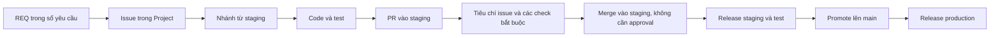

# Luồng làm việc

## Từng bước

1. **Chọn issue.** Chưa có issue thì tạo mới từ mẫu. Issue phải gắn REQ và có đủ thông tin theo [hướng dẫn đóng góp](https://github.com/netverse3d/netverse3d/blob/staging/CONTRIBUTING.md).
2. **Nhận việc:** tự gán Assignees, điền Start date và Target date, chuyển Status sang `Ready`.
3. **Tạo nhánh** từ `staging`: `feat/<issue>-<slug>`.
4. **Liên kết yêu cầu:** `pnpm trace:link REQ-001`.
5. **Làm việc:** commit nhỏ, viết test, cập nhật wiki nếu hành vi đổi.
6. **Kiểm tra:** `pnpm verify`.
7. **Mở PR** vào `staging`, mô tả có `Closes #<issue>` và REQ hoặc ADR. Mỗi PR đóng đúng một issue.
8. **Đối chiếu trước khi merge:** người merge xác nhận mục "Xong khi nào" của issue đã đạt, thay đổi đáp ứng yêu cầu và toàn bộ check bắt buộc xanh. Không cần approval; review là tùy chọn.
9. **Merge bằng squash,** nhánh tự xoá, issue tự đóng. Góp ý tùy chọn dùng review `COMMENT`. Nếu review `CHANGES_REQUESTED` đang chặn PR, người merge chỉ dismiss sau khi đã xác nhận issue và checks đạt; không cần reviewer approve.

## Issue

| Loại    | Dùng khi                                                              |
| ------- | --------------------------------------------------------------------- |
| Feature | Một khả năng mới cho người dùng; thường là issue cha có các issue con |
| Task    | Một việc làm được trong vài ngày                                      |
| Bug     | Hành vi sai so với REQ                                                |

Chọn mẫu phù hợp và điền Type, area, Milestone, Priority và Effort trong form issue. Workflow tự đồng bộ các câu trả lời vào metadata của issue khi tạo hoặc sửa. Task và Bug cần Effort; Feature không cần. Nếu dữ liệu thiếu hoặc không hợp lệ, workflow gắn `needs-triage`; sửa câu trả lời trong thân issue rồi lưu để workflow chạy lại. Khi hợp lệ, workflow đồng bộ metadata và gỡ nhãn này. Không tự điền Priority hoặc Effort cho issue cũ khi audit.

Assignees, Start date và Target date phải có trước khi chuyển sang `Ready`. Priority, Effort và hai ngày là field của issue; Project chỉ giữ Status. PR đóng issue bị CI chặn nếu metadata bắt buộc còn thiếu hoặc vẫn có `needs-triage`. Chạy audit chỉ đọc bằng `pnpm issues:audit`; hướng dẫn xem preview và áp dụng thay đổi nhãn nằm trong [runbook chất lượng issue](../../runbooks/issue-quality.md). Thang đo và trách nhiệm từng vai nằm ở [hướng dẫn đóng góp](https://github.com/netverse3d/netverse3d/blob/staging/CONTRIBUTING.md).

## Khi nào một việc sẵn sàng làm

- Gắn với REQ đã chốt hoặc có quyết định rõ.
- Biết cách kiểm là xong, đã ghi ở mục "Xong khi nào" của issue.
- Có người nhận, ngày bắt đầu và hạn.
- Không còn câu hỏi chặn trong [câu hỏi mở](../open-questions.md).

## Khi nào một việc xong

- Tiêu chí issue đạt, CI xanh và đã merge vào `staging`; không yêu cầu approval.
- Có test nói được hành vi.
- Đã kiểm trên staging nếu người dùng thấy được.
- Wiki, hợp đồng và trạng thái REQ đã cập nhật.

## Khi có dấu hiệu lệch nghiệp vụ

Lệch nghĩa là việc đang làm trái với REQ hoặc ADR, hoặc chưa có REQ nào phủ.

1. Dừng lại, đừng tự chọn.
2. Hỏi người phụ trách hoặc cả nhóm, kèm các lựa chọn và hệ quả.
3. Ghi kết quả: sửa `docs/requirements/registry.yaml` hoặc thêm ADR.
4. Làm tiếp theo quyết định mới.

Hệ thống hỏi lại ở ba chỗ:

| Lớp        | Khi nào                                  | Có bỏ qua được không                           |
| ---------- | ---------------------------------------- | ---------------------------------------------- |
| Công cụ AI | Khi sắp sửa mã sản phẩm chưa gắn yêu cầu | Được, tuỳ công cụ                              |
| Git hook   | Khi push                                 | Được, sau khi xác nhận                         |
| CI         | Khi mở PR                                | Không, thiếu REQ hoặc ADR thì không merge được |

CI cũng từ chối mọi PR vào `staging` không có `Closes #<issue>`.

CI chỉ kiểm được việc có gắn yêu cầu, không biết mã có đúng yêu cầu. Người merge đối chiếu chức năng và kết quả với tiêu chí issue; approval của reviewer không phải điều kiện.

## Ngoại lệ không cần REQ

PR chỉ đổi tài liệu, công cụ, CI không bắt buộc có REQ nhưng vẫn phải đóng một issue. Nếu có nhắc REQ hoặc ADR thì mã đó vẫn phải tồn tại.

PR đưa `staging` lên `main` được miễn cả REQ lẫn issue. Repo không dùng Dependabot; nâng thư viện là một việc có issue, theo [ADR-0032](../../decisions/ADR-0032-no-dependabot.md).

## Khi có góp ý review tùy chọn

CI không tự kiểm được những điều sau:

- PR chạm `.github/` hoặc `scripts/` có thể đang sửa chính bộ kiểm tra, nên người merge cần đối chiếu kỹ hơn với issue và trạng thái checks.
- REQ hoặc ADR mới do chính PR thêm vào chỉ gây cảnh báo; người merge xác nhận quyết định đó đã được thống nhất và ghi trong issue.
- Review là tùy chọn. Dùng `COMMENT` để góp ý mà không tạo trạng thái `CHANGES_REQUESTED` chặn PR.
